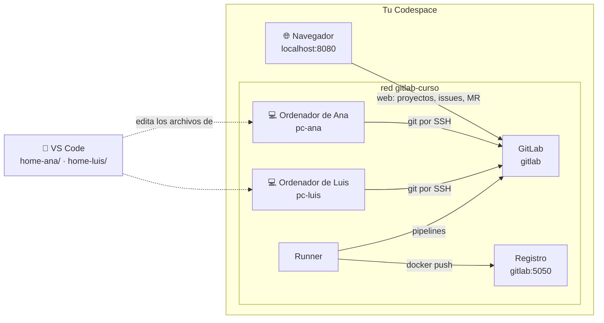

# El entorno de prácticas

[← Volver al curso](../README.md)

En el curso trabajas en un equipo simulado dentro de tu Codespace: un servidor GitLab, un runner que ejecuta los pipelines y **un ordenador para cada miembro del equipo**. Cada ordenador es un contenedor Ubuntu en la misma red que GitLab. Nadie más entra en tu entorno: cuando una práctica necesita a dos personas, haces tú de las dos, cambiando de ordenador y de sesión en GitLab.



| Quién | Usuario de GitLab | Ordenador | Su carpeta en VS Code | Correo |
|-------|-------------------|-----------|-----------------------|--------|
| Ana, dueña del proyecto | `ana` | `pc-ana` | `home-ana/` | `ana@equipo.local` |
| Luis, compañero de equipo | `luis` | `pc-luis` | `home-luis/` | `luis@equipo.local` |

Contraseña de las dos cuentas: `Formacion-2026!`.

## Dónde estás en cada paso

Las páginas marcan siempre desde dónde se hace cada cosa. Hay cuatro sitios:

### 🖥️ Terminal del Codespace

Es tu terminal, la que abre VS Code. Solo se usa para levantar el entorno, preparar el punto de partida de una página (`scripts/partida.sh`) y **entrar en el ordenador** de alguien. Sus bloques empiezan así:

```bash
# 🖥️ Terminal del Codespace
docker exec -it pc-ana bash
```

### 💻 Ordenador de Ana / 💻 Ordenador de Luis

Después de `docker exec -it pc-ana bash` estás **dentro del ordenador de Ana**: lo que escribas lo hace Ana, con su configuración de Git y su clave SSH. Lo confirma el prompt:

```text
ana@pc-ana:~$
```

Los bloques que se ejecutan ahí empiezan con el nombre del ordenador:

```bash
# 💻 Ordenador de Ana
git status
```

Si el prompt no dice `ana@pc-ana`, no estás donde dice el bloque. Para salir del ordenador y volver al Codespace, `exit`. En la terminal de un ordenador solo se usa Git (y, al principio, la clave SSH); los archivos se editan con VS Code.

> [!TIP]
> Abre una pestaña de terminal por persona (botón **+** del panel de terminal) y entra en cada una en un ordenador. Así cambiar de Ana a Luis es cambiar de pestaña, y el prompt te dice en cuál estás.

### 📝 VS Code, en el ordenador de Ana / de Luis

La carpeta personal de Ana (`/home/ana` dentro de su ordenador) es la carpeta **`home-ana/`** del explorador de VS Code, y la de Luis es **`home-luis/`**. No son copias: son la misma carpeta vista desde dos sitios. Lo que guardas en `home-ana/trabajo/…` con VS Code aparece al instante en el ordenador de Ana, y lo que Git crea o cambia allí lo ves en VS Code.

Por eso, cuando una página dice

> **Acción** (📝 VS Code, ordenador de Ana): en `home-ana/trabajo/manual-m02-clonar/docs/normas-de-trabajo.md`, cambia …

abres ese archivo en el explorador de VS Code, haces el cambio y guardas (**Ctrl+S**). Es Ana editando en su ordenador. La ruta empieza siempre por la carpeta de la persona: si empieza por `home-ana/`, el archivo es de Ana; si empieza por `home-luis/`, de Luis.

> [!WARNING]
> No edites el mismo proyecto desde la carpeta equivocada: `home-ana/trabajo/manual-m04-revision` y `home-luis/trabajo/manual-m04-revision` son dos copias distintas, una en cada ordenador, como en un equipo de verdad.

### 🌐 GitLab, sesión de Ana / sesión de Luis

La parte web se hace en el navegador, con la sesión iniciada como una de las dos personas. Para tener a las dos a la vez, usa una ventana normal para Ana y una **ventana privada** para Luis. El nombre de usuario aparece en el avatar, arriba a la izquierda.

## Arrancar

Se hace una vez, desde el terminal del Codespace. Necesita unos 6 GB de memoria libres (el Codespace del curso tiene 4 núcleos y 16 GB).

```bash
# 🖥️ Terminal del Codespace
infra/bootstrap.sh
```

El script crea las carpetas `home-ana/` y `home-luis/`, arranca GitLab, el runner y los dos ordenadores, registra el runner y crea las cuentas `ana` y `luis`. La primera vez GitLab tarda unos minutos en responder. Al terminar muestra:

```text
GitLab listo: http://localhost:8080  ·  usuarios: ana luis  ·  contraseña: Formacion-2026!
Registro de imágenes: gitlab:5050
Ordenadores: docker exec -it pc-ana bash  ·  docker exec -it pc-luis bash
```

GitLab se abre en `http://localhost:8080`. En un Codespace, abre la pestaña **Ports** de VS Code y pulsa el globo de la fila **8080**.

Si el puerto 8080 está ocupado, usa otro: `GITLAB_PORT=8929 infra/bootstrap.sh`. El registro sigue en el puerto 5050.

## Registro de imágenes

GitLab guarda imágenes Docker del proyecto. Desde el Codespace y desde los jobs del pipeline el registro se llama `gitlab:5050`. El arranque deja ese nombre apuntando a esta máquina, acepta el registro por HTTP y permite que el runner ejecute `docker build` y `docker push`. El navegador sigue en `http://localhost:8080`.

```bash
# 🖥️ Terminal del Codespace
curl -s -o /dev/null -w '%{http_code}\n' http://gitlab:5050/v2/
```

```text
401
```

`401` es la respuesta de un registro en marcha: pide identificarse. Las prácticas de [Publicar una versión](../labs/M07-publicar-version/README.md) publican ahí la imagen del proyecto.

## El punto de partida de cada página

Cada laboratorio empieza con su propio proyecto. `scripts/partida.sh` lo crea en el espacio de una persona, con el contenido del proyecto y un historial inicial, y lo clona en su ordenador:

```bash
# 🖥️ Terminal del Codespace
scripts/partida.sh ana manual-m02-clonar
```

```text
Creando ana/manual-m02-clonar en GitLab…
Proyecto: http://localhost:8080/ana/manual-m02-clonar
Copia local: ~/trabajo/manual-m02-clonar en el ordenador de ana (pc-ana)
```

Si esa persona todavía no tiene clave SSH (no ha hecho el [lab de identidad y acceso](../labs/M01-introduccion-git-gitlab/01-lab-identidad-y-acceso.md)), el script la crea y la registra en GitLab para que la página se pueda hacer igualmente.

## Parar y borrar

| Qué | Comando (🖥️ terminal del Codespace) |
|-----|---------|
| Parar, conservando los datos | `docker compose -f infra/compose.yaml stop` |
| Volver a arrancar | `docker compose -f infra/compose.yaml start` |
| Borrarlo todo y empezar de cero | `docker compose -f infra/compose.yaml down -v && rm -rf infra/.env home-ana home-luis` |

Borrarlo todo elimina también los ordenadores de Ana y Luis: su configuración de Git, sus claves SSH y sus carpetas de trabajo, que viven en `home-ana/` y `home-luis/`.
