# Lab — Primer proyecto

[← Página anterior](01-lab-identidad-y-acceso.md) · [Siguiente página →](../M02-operaciones-basicas/README.md)

El proyecto necesita un sitio común donde todos vean la misma versión y su historial. En este lab Ana crea el proyecto `manual-equipo` en GitLab, recorre las secciones que se usan en el resto del curso y hace su primer commit sin salir del navegador. Todo el lab se hace en el navegador, con la sesión de Ana.

### Objetivo

El proyecto `ana/manual-equipo` creado con su `README.md`, editado desde la web, y dos commits visibles en **Code** → **Commits**.

### Punto de partida

- El entorno de prácticas levantado ([El entorno de prácticas](../../infra/README.md)): GitLab en `http://localhost:8080`.
- Cuenta de Ana: usuario `ana`, contraseña `Formacion-2026!`.
- No hace falta nada de páginas anteriores ni se usa la terminal. Si ya tienes un proyecto llamado `manual-equipo`, usa `manual-equipo-web` en el paso 3 y en el resto de rutas.

### En qué consiste

Con la sesión de Ana creas un proyecto en blanco con README, visitas sus secciones principales para saber qué hay en cada una y cambias el README con un commit desde la interfaz web. Al final miras la dirección con la que el ordenador de Ana lo clonará por SSH; clonarlo y trabajar desde su ordenador queda para el siguiente módulo.

### 1 — Entra en GitLab como Ana

**Acción** (🌐 GitLab, sesión de Ana): abre `http://localhost:8080`, escribe `ana` y `Formacion-2026!` y pulsa **Sign in**. Si ya estás dentro con otra cuenta, sal antes desde el avatar (**Sign out**).

**Por qué:** el proyecto se crea en el espacio personal de quien tiene la sesión iniciada. Con la sesión de Ana, el proyecto será `ana/manual-equipo`.

**Resultado esperado:** la página de inicio con la barra lateral izquierda y el avatar de Ana.

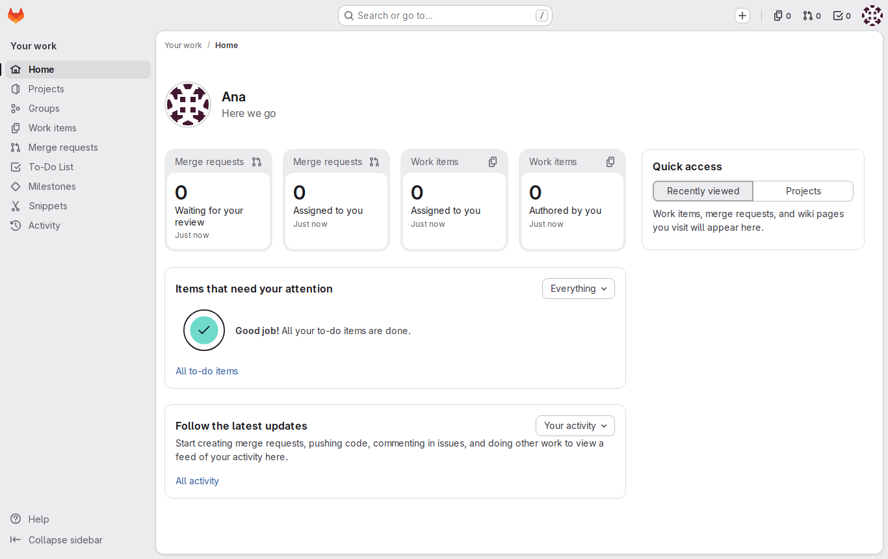

### 2 — Empieza un proyecto nuevo

**Acción** (🌐 GitLab, sesión de Ana):
1. En la parte superior de la barra lateral, pulsa **+** y elige **New project/repository**.
2. Pulsa **Create blank project**.

**Por qué:** el proyecto se empieza desde cero; las otras opciones (plantilla, importar) traen contenido que no es el del equipo.

**Resultado esperado:** el formulario **Create blank project**.

### 3 — Rellena los datos del proyecto

**Acción** (🌐 GitLab, sesión de Ana):
1. En **Project name**, escribe `manual-equipo`.
2. En **Project URL**, abre el desplegable **Select a group or namespace** y elige `ana`: GitLab no lo deja elegido de antemano. Comprueba que **Project slug** es `manual-equipo`.
3. En **Visibility Level**, elige **Private**.
4. En **Project Configuration**, deja marcada **Initialize repository with a README**.

**Por qué:** la URL del proyecto será `http://localhost:8080/ana/manual-equipo`. Privado: solo Ana y los miembros que añada lo ven; Luis, de momento, no. El README inicial deja el repositorio con un primer commit y la rama `main`, en lugar de vacío.

**Resultado esperado:** el formulario sin avisos en rojo. Si queda el aviso «Select where to create this project.», falta elegir `ana` en **Project URL**.

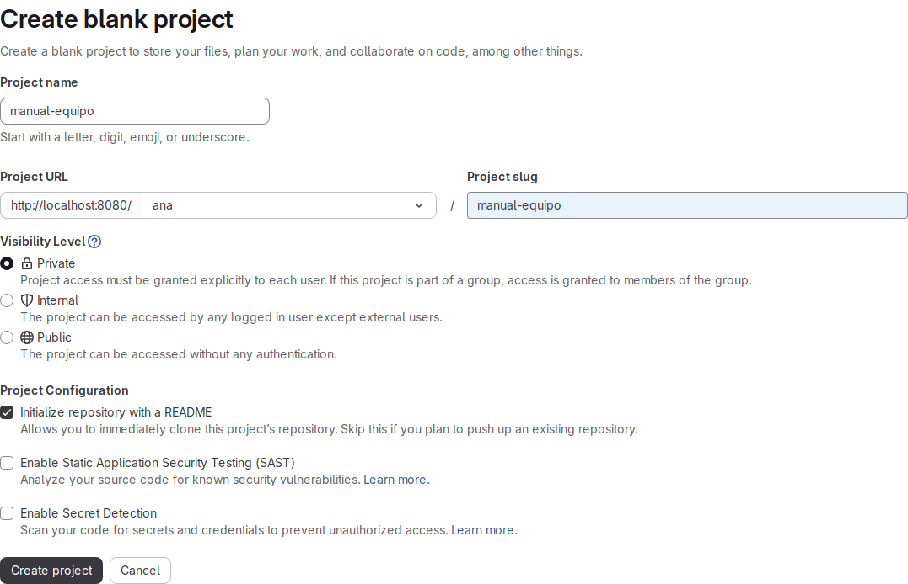

### 4 — Crea el proyecto

**Acción** (🌐 GitLab, sesión de Ana): pulsa **Create project**.

**Por qué:** a partir de aquí el repositorio existe en el servidor y tiene historial.

**Resultado esperado:** la página del proyecto `manual-equipo` con un aviso de proyecto creado, la rama `main`, un commit y la lista de archivos con `README.md`. Debajo, el contenido del README renderizado.

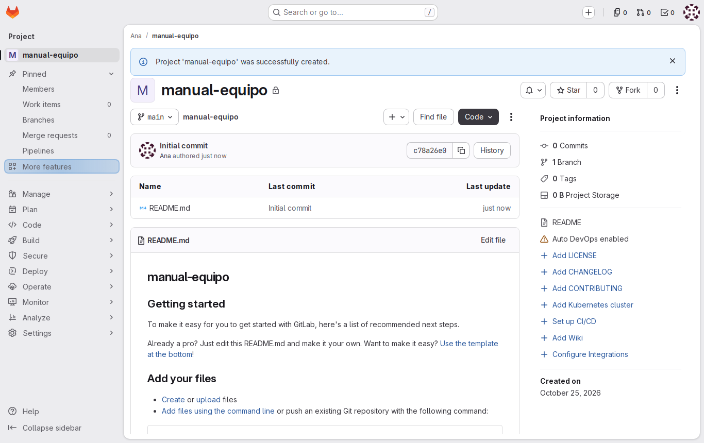

### 5 — Code → Repository

**Acción** (🌐 GitLab, sesión de Ana): en la barra lateral, pulsa **Code** → **Repository**.

**Por qué:** es la vista de los archivos del proyecto en una rama. Aquí verás `docs/` y las páginas cuando las subas.

**Resultado esperado:** el selector de rama con `main`, la última línea de commit (`Initial commit`, de Ana) y la tabla de archivos con `README.md`.

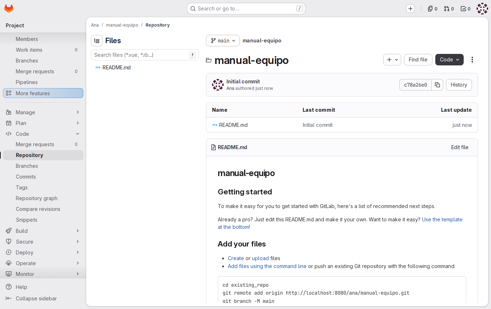

### 6 — Plan → Work items

**Acción** (🌐 GitLab, sesión de Ana): pulsa **Plan** → **Work items**.

**Por qué:** las tareas del proyecto («falta la página de vacaciones», «el horario está desactualizado») se registran como issues. En GitLab 19 viven en **Work items**: un work item puede ser una issue, una tarea o un incidente. Se usan en el M04.

**Resultado esperado:** la lista vacía con el botón **New item**.

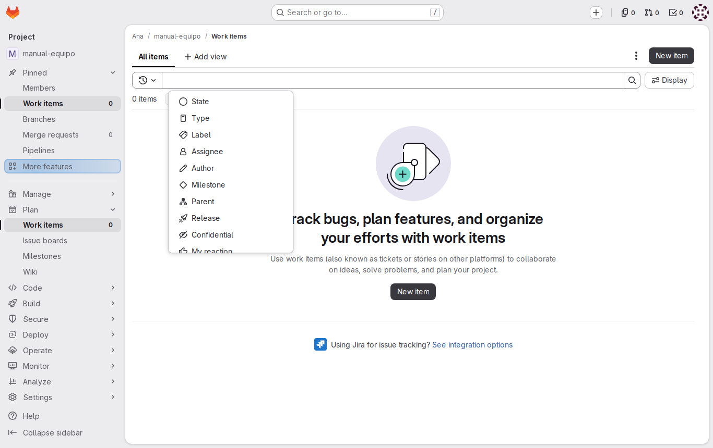

### 7 — Code → Merge requests

**Acción** (🌐 GitLab, sesión de Ana): pulsa **Code** → **Merge requests**.

**Por qué:** una merge request es la propuesta de integrar los cambios de una rama en `main`, con revisión. Es como entra cada cambio en el proyecto.

**Resultado esperado:** la lista vacía, sin merge requests abiertas.

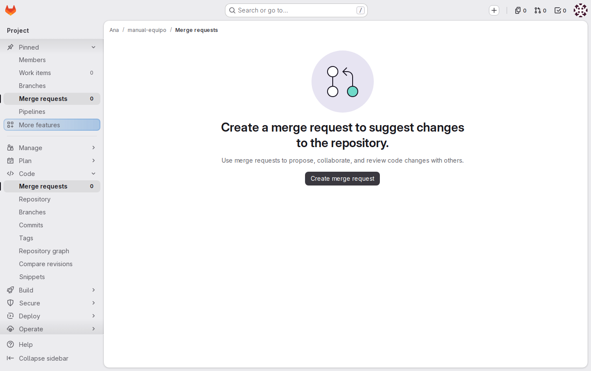

### 8 — Build → Pipelines

**Acción** (🌐 GitLab, sesión de Ana): pulsa **Build** → **Pipelines**.

**Por qué:** cuando el proyecto tenga un `.gitlab-ci.yml`, cada push lanzará un pipeline que comprueba las páginas del proyecto. Se ve en el M05.

**Resultado esperado:** el aviso «There are currently no pipelines.» y el botón **New pipeline**: el proyecto aún no tiene `.gitlab-ci.yml`.

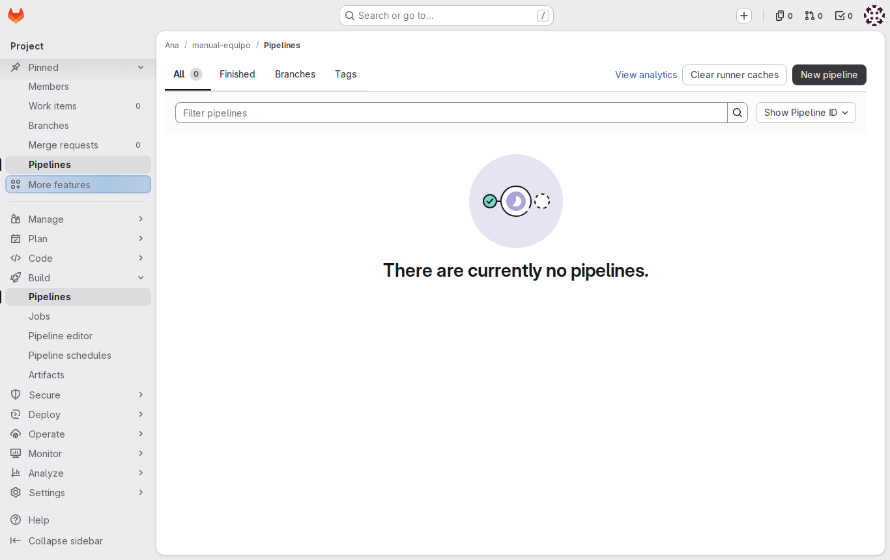

### 9 — Manage → Members

**Acción** (🌐 GitLab, sesión de Ana): pulsa **Manage** → **Members**.

**Por qué:** aquí se decide quién más trabaja en el proyecto y con qué rol. En el M04, Ana añade aquí a Luis.

**Resultado esperado:** la tabla de miembros con una sola fila: Ana (`@ana`), con el rol **Owner**.

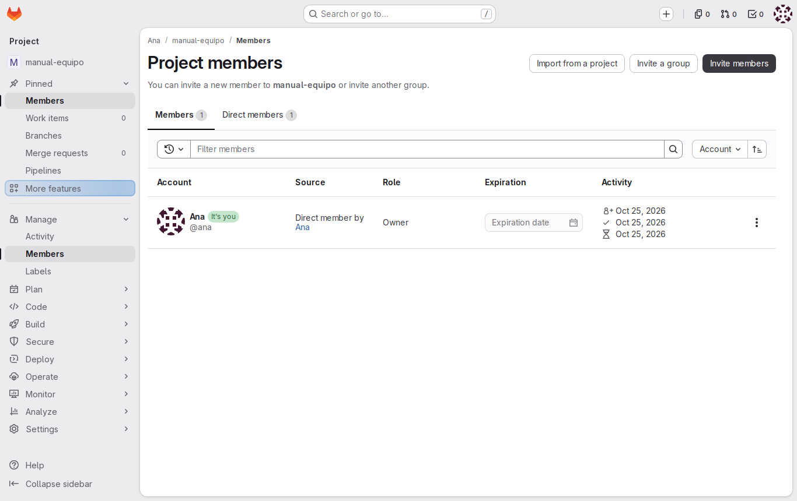

### 10 — Settings

**Acción** (🌐 GitLab, sesión de Ana): pulsa **Settings** → **General** y despliega **Visibility, project features, permissions** con **Expand**. Después, abre **Settings** → **Repository** y despliega **Protected branches**.

**Por qué:** en **General** está la visibilidad que elegiste en el paso 3; en **Repository** → **Protected branches**, las reglas de la rama `main`, que en el M04 se cierran para que solo se integre por merge request.

**Resultado esperado:** **Project visibility** en **Private**, y en **Protected branches** una fila para `main`.

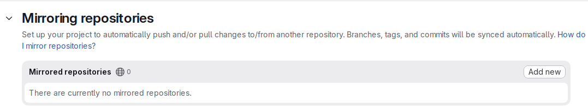

### 11 — Abre el README para editarlo

**Acción** (🌐 GitLab, sesión de Ana):
1. Vuelve a **Code** → **Repository** y pulsa `README.md`.
2. Pulsa **Edit** y elige **Edit single file**.

**Por qué:** el README que genera GitLab es genérico; el del proyecto tiene que decir qué es.

**Resultado esperado:** un editor con el contenido actual del README, las pestañas **Write** y **Preview** y, debajo, el botón **Commit changes**.

### 12 — Escribe el README del proyecto

**Acción** (🌐 GitLab, sesión de Ana): borra todo el contenido y escribe:

```markdown
# Manual del equipo

Todo lo que necesita saber una persona que se incorpora al equipo.
```

**Por qué:** es la cabecera que tendrá el documento completo; el título en la primera línea es lo que el pipeline del M05 exige a cada página.

**Resultado esperado:** el editor solo con esas tres líneas. La pestaña **Preview** muestra el título grande y la frase debajo.

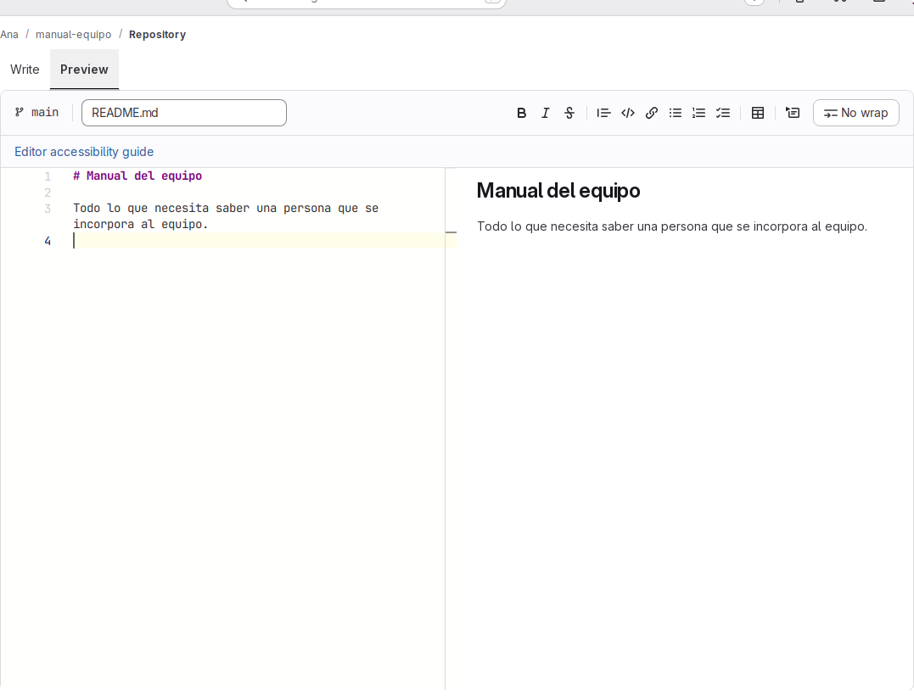

### 13 — Haz el commit desde la web

**Acción** (🌐 GitLab, sesión de Ana):
1. Pulsa **Commit changes**. Se abre un diálogo.
2. En **Commit message**, sustituye el texto propuesto por `Describe el manual del equipo`.
3. En **Branch**, deja **Commit to the current main branch**.
4. Pulsa **Commit changes** en el diálogo.

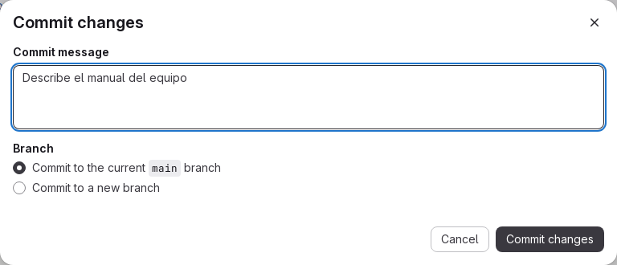

**Por qué:** la web no guarda archivos sueltos: cada edición es un commit, con autor y mensaje, igual que `git commit` en la terminal. El mensaje explica el porqué al que lea el historial.

**Resultado esperado:** la página de `README.md` con el contenido nuevo y un aviso de que los cambios se han guardado. Encima del archivo, la línea del último commit: `Describe el manual del equipo`.

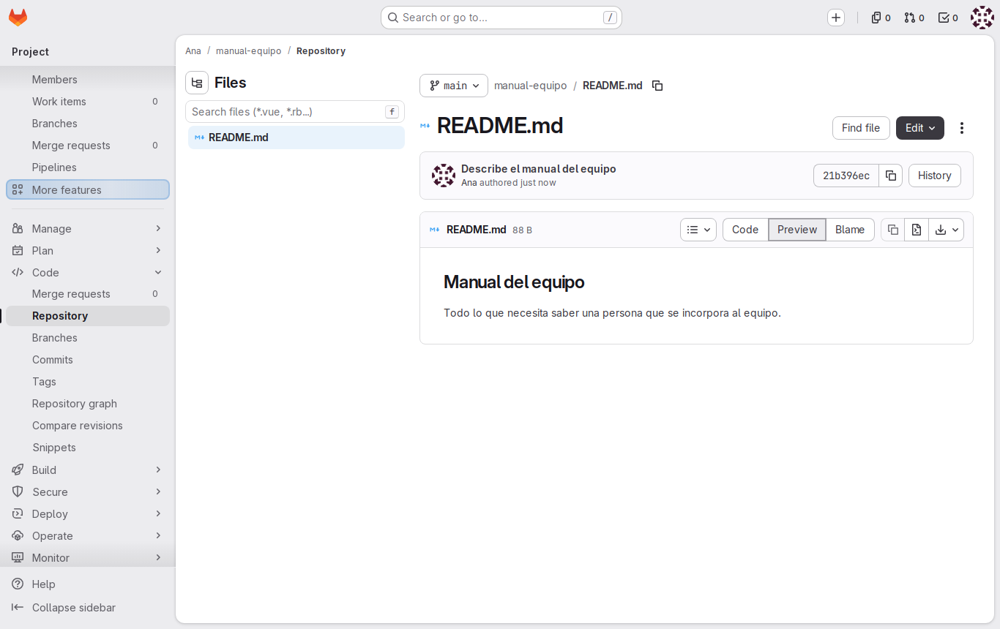

### 14 — Code → Commits

**Acción** (🌐 GitLab, sesión de Ana): pulsa **Code** → **Commits**.

**Por qué:** es el historial del proyecto: lo que la carpeta compartida no tenía.

**Resultado esperado:** dos commits en `main`, del más reciente al más antiguo: `Describe el manual del equipo` e `Initial commit`, los dos de Ana. Al pulsar el primero se ve su diff: en rojo las líneas del README genérico y en verde las tres nuevas.

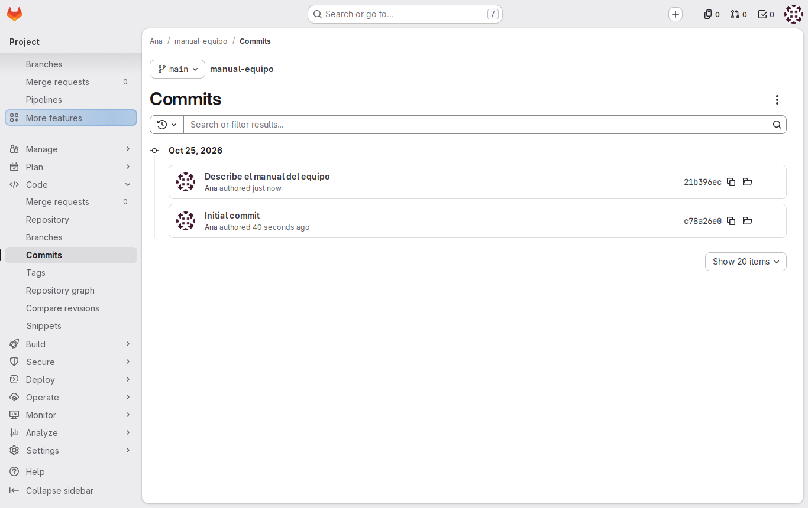

### 15 — La dirección para clonar por SSH

**Acción** (🌐 GitLab, sesión de Ana): vuelve a la página del proyecto y pulsa el botón **Code**.

**Por qué:** es la dirección con la que el ordenador de Ana clonará el proyecto en el M02. En el curso se usa **Clone with SSH**, que funciona con la clave que Ana registró en el [lab de identidad y acceso](01-lab-identidad-y-acceso.md): `git@gitlab` es GitLab visto desde la red de los ordenadores del equipo, y `ana/manual-equipo` es la ruta del proyecto.

**Resultado esperado:** un desplegable con **Clone with SSH**: `git@gitlab:ana/manual-equipo.git`, y debajo **Clone with HTTP**.

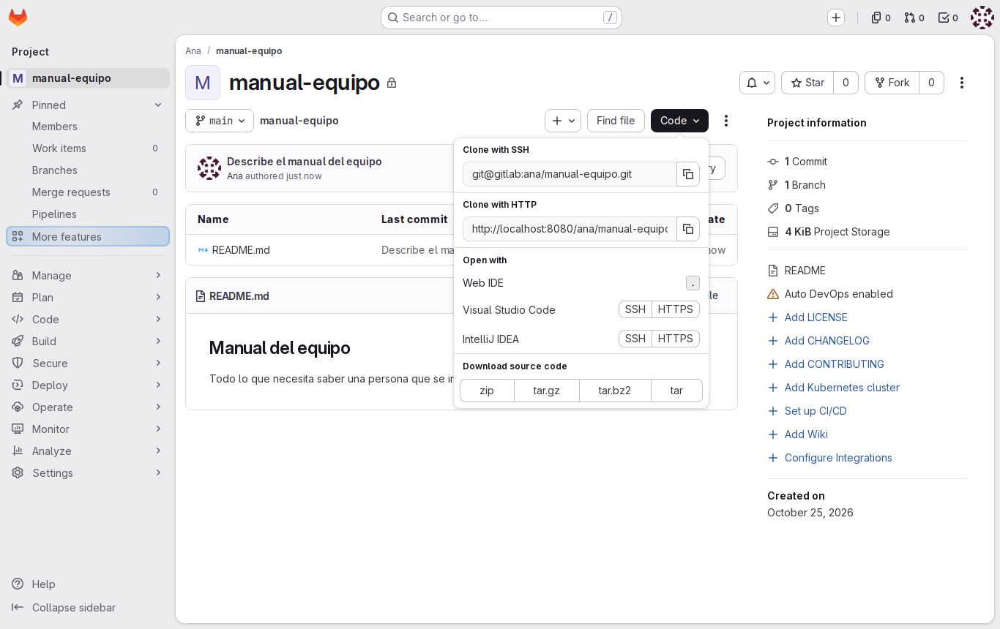

## Comprueba tu entendimiento

**El historial cuenta lo que hiciste**
Abre **Code** → **Commits** en `manual-equipo`.
→ Dos commits, el último `Describe el manual del equipo`, con Ana como autora.

**El proyecto es de Ana y privado**
Abre **Manage** → **Members**. Después, en una ventana privada, entra como `luis` y abre `http://localhost:8080/ana/manual-equipo`.
→ Solo Ana, con el rol **Owner**. Luis ve una página de error 404: para él, el proyecto no existe hasta que Ana lo añada como miembro (M04).

**Cada sección, su función**
Sin abrirlas, di dónde mirarías si un compañero propone un cambio en el horario, si alguien avisa de un enlace roto y si quieres saber si las páginas pasan la validación. Después compruébalo en la barra lateral.
→ **Code** → **Merge requests**, **Plan** → **Work items** y **Build** → **Pipelines**.

## Reto

### 1 — Añade la página de bienvenida desde la web

Crea en el proyecto el archivo `docs/bienvenida.md` con la línea `# Bienvenida`, en un commit con el mensaje `Añade la página de bienvenida`, sin usar la terminal.

<details>
<summary>Ver solución</summary>

En **Code** → **Repository**, pulsa **+** (junto al nombre del proyecto) → **New file**. En el nombre del archivo escribe `docs/bienvenida.md` (la barra crea la carpeta `docs/`), en el contenido `# Bienvenida`, y pulsa **Commit changes**. En el diálogo, **Commit message** `Añade la página de bienvenida`, **Commit to the current main branch** y **Commit changes**. En **Code** → **Repository** aparece la carpeta `docs/`, y en **Code** → **Commits**, tres commits.

</details>

## Errores frecuentes

| Síntoma | Causa probable | Cómo arreglarlo |
|---------|----------------|-----------------|
| Al crear el proyecto, aviso en rojo de que el nombre o la ruta ya están en uso | Ana ya tiene un proyecto `manual-equipo` en su espacio | Usa `manual-equipo-web` como nombre, o abre el que ya tienes |
| La página del proyecto dice que el repositorio está vacío y no hay `README.md` | Se desmarcó **Initialize repository with a README** | Añade el archivo desde la web (**+** → **New file**, nombre `README.md`) o borra el proyecto y créalo otra vez |
| Tras **Commit changes** se abre un formulario de merge request y `main` no cambia | En el diálogo se eligió **Commit to a new branch** | Cierra el formulario sin crearla; repite el paso 13 con **Commit to the current main branch** |
| No aparece **New project/repository** o GitLab no deja crear el proyecto | No estás con la sesión de Ana, o la cuenta no se creó bien | Comprueba el avatar; si la cuenta `ana` no existe, ejecuta `infra/bootstrap.sh` en el terminal del Codespace |
| **Settings** no aparece en la barra lateral | Estás con la sesión de Luis, o en un proyecto que no es de Ana | Comprueba el avatar y que la ruta sea `ana/manual-equipo` |
