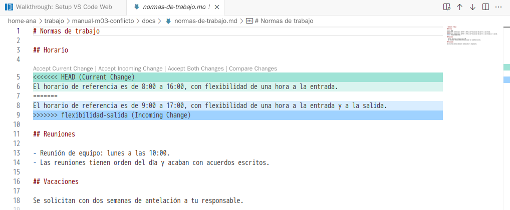
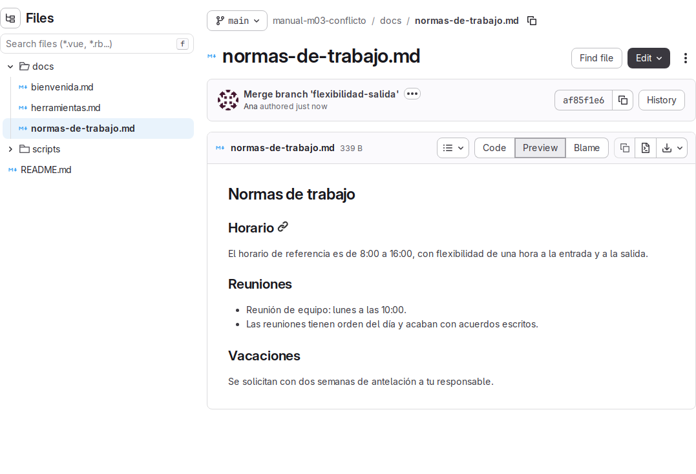

# Lab — Conflicto

[← Página anterior](01-lab-rama-y-merge.md) · [Siguiente página →](03-buenas-practicas.md)

Dos cambios llegan a la vez a las normas de trabajo del proyecto: uno adelanta el horario de referencia a las 8:00 y otro amplía la flexibilidad a la salida. Los dos tocan la misma frase de `docs/normas-de-trabajo.md`, así que Git no puede decidir solo cómo queda. En este lab, en el ordenador de Ana, provocas ese conflicto, lees lo que Git te enseña, dejas la frase como la ha acordado el equipo y publicas el resultado.

### Objetivo

Un `main` en GitLab cuya sección **Horario** dice «El horario de referencia es de 8:00 a 16:00, con flexibilidad de una hora a la entrada y a la salida.», integrado con un commit de merge en el que Ana resolvió el conflicto.

### Punto de partida

- El entorno de prácticas levantado ([El entorno de prácticas](../../infra/README.md)).
- Estado: en el terminal del Codespace, ejecuta:

  ```bash
  # 🖥️ Terminal del Codespace
  scripts/partida.sh ana manual-m03-conflicto
  docker exec -it pc-ana bash
  ```

  Crea `ana/manual-m03-conflicto` en GitLab con el contenido del proyecto y tres commits en `main`, lo clona en `~/trabajo/manual-m03-conflicto` del ordenador de Ana y deja allí su identidad de Git y su clave SSH. El segundo comando te sienta en el ordenador de Ana.

### En qué consiste

Preparas dos ramas que cambian la misma línea de `docs/normas-de-trabajo.md`, fusionas la primera sin problemas y, al fusionar la segunda, aparece el conflicto. Lo lees, pruebas a abortar el merge, lo repites y lo resuelves. No tocas otras páginas.

La línea de partida, en la sección **Horario**, es esta:

```markdown
El horario de referencia es de 9:00 a 17:00, con flexibilidad de una hora a la entrada.
```

### 1 — Crea la primera rama y cambia el horario

**Acción** (💻 Ordenador de Ana):

```bash
# 💻 Ordenador de Ana
cd ~/trabajo/manual-m03-conflicto
git switch -c horario-de-8
```

**Acción** (📝 VS Code, ordenador de Ana): en `home-ana/trabajo/manual-m03-conflicto/docs/normas-de-trabajo.md`, cambia `de 9:00 a 17:00` por `de 8:00 a 16:00` y guarda. Revisa el cambio en el ordenador de Ana con `git diff`.

**Por qué:** es el primer cambio que pide el equipo: adelantar el horario.

**Resultado esperado:**

```text
-El horario de referencia es de 9:00 a 17:00, con flexibilidad de una hora a la entrada.
+El horario de referencia es de 8:00 a 16:00, con flexibilidad de una hora a la entrada.
```

### 2 — Confirma el cambio de horario

**Acción** (💻 Ordenador de Ana): `git commit -am "Adelanta el horario de referencia a las 8:00"`

**Por qué:** el cambio queda guardado en `horario-de-8`; `main` sigue con el horario de 9:00 a 17:00.

**Resultado esperado:**

```text
[horario-de-8 1e4a596] Adelanta el horario de referencia a las 8:00
 1 file changed, 1 insertion(+), 1 deletion(-)
```

### 3 — Crea la segunda rama desde `main`

**Acción** (💻 Ordenador de Ana):

```bash
# 💻 Ordenador de Ana
git switch main
git switch -c flexibilidad-salida
```

**Por qué:** la segunda persona parte del proyecto publicado, sin saber nada del cambio de horario. Por eso la rama sale de `main` y no de `horario-de-8`.

**Resultado esperado:**

```text
Switched to branch 'main'
Your branch is up to date with 'origin/main'.
Switched to a new branch 'flexibilidad-salida'
```

En VS Code, `docs/normas-de-trabajo.md` vuelve a decir `de 9:00 a 17:00`: la rama nueva sale de `main`, que no tiene el cambio de la otra rama.

### 4 — Amplía la flexibilidad y confírmalo

**Acción** (📝 VS Code, ordenador de Ana): en `home-ana/trabajo/manual-m03-conflicto/docs/normas-de-trabajo.md`, en la misma frase, cambia `a la entrada.` por `a la entrada y a la salida.` y guarda. Después, confírmalo en el ordenador de Ana (💻):

```bash
# 💻 Ordenador de Ana
git commit -am "Amplía la flexibilidad del horario a la salida"
```

**Por qué:** es el segundo cambio, sobre la misma línea que el primero. Esto es lo que provocará el conflicto.

**Resultado esperado:**

```text
[flexibilidad-salida 4e051f3] Amplía la flexibilidad del horario a la salida
 1 file changed, 1 insertion(+), 1 deletion(-)
```

### 5 — Mira las dos ramas en el grafo

**Acción** (💻 Ordenador de Ana):

```bash
# 💻 Ordenador de Ana
git switch main
git log --oneline --graph --all
```

**Por qué:** antes de fusionar, ves que las dos ramas salen del mismo commit y que cada una tiene un cambio propio.

**Resultado esperado:**

```text
* 4e051f3 (flexibilidad-salida) Amplía la flexibilidad del horario a la salida
| * 1e4a596 (horario-de-8) Adelanta el horario de referencia a las 8:00
|/  
* 5f2e0c4 (HEAD -> main, origin/main, origin/HEAD) Añade normas de trabajo y scripts de validación
* 97887a6 Añade bienvenida y herramientas
* a008e0f Crea el manual del equipo
```

### 6 — Fusiona la primera rama

**Acción** (💻 Ordenador de Ana): `git merge horario-de-8`

**Por qué:** `main` no ha cambiado desde que creaste la rama, así que esta fusión no tiene nada que mezclar.

**Resultado esperado:** un *fast-forward*, sin conflicto:

```text
Updating 5f2e0c4..1e4a596
Fast-forward
 docs/normas-de-trabajo.md | 2 +-
 1 file changed, 1 insertion(+), 1 deletion(-)
```

### 7 — Fusiona la segunda rama

**Acción** (💻 Ordenador de Ana): `git merge flexibilidad-salida`

**Por qué:** ahora `main` ya dice `de 8:00 a 16:00` y la rama trae otra versión de la misma línea, escrita sobre `de 9:00 a 17:00`. Git no sabe con cuál quedarse.

**Resultado esperado:** Git para y avisa del conflicto:

```text
Auto-merging docs/normas-de-trabajo.md
CONFLICT (content): Merge conflict in docs/normas-de-trabajo.md
Automatic merge failed; fix conflicts and then commit the result.
```

> [!NOTE]
> No se ha roto nada. El merge está a medias, esperando a que decidas el texto.

### 8 — Lee el estado

**Acción** (💻 Ordenador de Ana): `git status`

**Por qué:** te dice en qué punto estás y las dos salidas posibles: terminar el merge o abortarlo.

**Resultado esperado:**

```text
On branch main
Your branch is ahead of 'origin/main' by 1 commit.
  (use "git push" to publish your local commits)

You have unmerged paths.
  (fix conflicts and run "git commit")
  (use "git merge --abort" to abort the merge)

Unmerged paths:
  (use "git add <file>..." to mark resolution)
	both modified:   docs/normas-de-trabajo.md

no changes added to commit (use "git add" and/or "git commit -a")
```

`both modified` significa que las dos ramas cambiaron ese archivo en el mismo sitio.

### 9 — Lee las marcas de conflicto

**Acción** (📝 VS Code, ordenador de Ana): abre `home-ana/trabajo/manual-m03-conflicto/docs/normas-de-trabajo.md`.

**Por qué:** Git ha escrito las dos versiones dentro del archivo, separadas por marcas, para que elijas.

**Resultado esperado:** la sección **Horario** queda así; el resto del archivo no cambia:

```text
## Horario

<<<<<<< HEAD
El horario de referencia es de 8:00 a 16:00, con flexibilidad de una hora a la entrada.
=======
El horario de referencia es de 9:00 a 17:00, con flexibilidad de una hora a la entrada y a la salida.
>>>>>>> flexibilidad-salida

## Reuniones
```

| Marca | Qué hay hasta la siguiente marca |
|-------|----------------------------------|
| `<<<<<<< HEAD` | La versión de la rama actual, `main`: lo que ya estaba fusionado |
| `=======` | Separador |
| `>>>>>>> flexibilidad-salida` | Cierra la versión que trae la rama que se está fusionando |

VS Code colorea el bloque y pone encima los enlaces **Accept Current Change** (quedarse con `HEAD`), **Accept Incoming Change** (quedarse con `flexibilidad-salida`), **Accept Both Changes** y **Compare Changes**. Lo único que hacen es editar el texto entre las marcas: el archivo sigue siendo el de Ana y Git solo ve el resultado.



### 10 — Prueba la salida de emergencia

**Acción** (💻 Ordenador de Ana): `git merge --abort` y después `git status`.

**Por qué:** si te encuentras un conflicto que no sabes resolver (o no te toca a ti decidir el texto), puedes volver a como estabas antes del merge sin perder nada.

**Resultado esperado:**

```text
On branch main
Your branch is ahead of 'origin/main' by 1 commit.
  (use "git push" to publish your local commits)

nothing to commit, working tree clean
```

El archivo vuelve a decir solo `de 8:00 a 16:00, con flexibilidad de una hora a la entrada.`, sin marcas.

### 11 — Vuelve a fusionar

**Acción** (💻 Ordenador de Ana): `git merge flexibilidad-salida`

**Por qué:** ahora sí vas a resolverlo. El equipo ha acordado quedarse con las dos cosas: el horario de 8:00 a 16:00 y la flexibilidad también a la salida.

**Resultado esperado:** el mismo aviso del paso 7, `CONFLICT (content): Merge conflict in docs/normas-de-trabajo.md`.

### 12 — Resuelve el conflicto

**Acción** (📝 VS Code, ordenador de Ana): en `home-ana/trabajo/manual-m03-conflicto/docs/normas-de-trabajo.md`, sustituye todo el bloque, desde `<<<<<<< HEAD` hasta `>>>>>>> flexibilidad-salida` incluidas, por esta única línea, y guarda:

```markdown
El horario de referencia es de 8:00 a 16:00, con flexibilidad de una hora a la entrada y a la salida.
```

**Por qué:** ninguna de las dos versiones es la buena por sí sola: cada una pierde el cambio de la otra. Por eso aquí no sirve **Accept Current Change** ni **Accept Incoming Change**: hay que escribir la frase a mano. Lo importante es que no quede ninguna marca.

**Resultado esperado:** `git diff` enseña el resultado frente a las dos versiones (una columna por rama):

```text
  ## Horario
  
- El horario de referencia es de 8:00 a 16:00, con flexibilidad de una hora a la entrada.
 -El horario de referencia es de 9:00 a 17:00, con flexibilidad de una hora a la entrada y a la salida.
++El horario de referencia es de 8:00 a 16:00, con flexibilidad de una hora a la entrada y a la salida.
```

> [!WARNING]
> Git no comprueba que hayas quitado las marcas. Si dejas `<<<<<<<` o `>>>>>>>` y confirmas, se publican tal cual en el proyecto. Comprueba siempre que no queda ninguna: en VS Code, busca `<<<<<<<` en el archivo (**Ctrl+F**).

### 13 — Marca el conflicto como resuelto

**Acción** (💻 Ordenador de Ana): `git add docs/normas-de-trabajo.md` y después `git status`.

**Por qué:** con `git add` le dices a Git que ese archivo ya tiene su versión final.

**Resultado esperado:**

```text
On branch main
Your branch is ahead of 'origin/main' by 1 commit.
  (use "git push" to publish your local commits)

All conflicts fixed but you are still merging.
  (use "git commit" to conclude merge)

Changes to be committed:
	modified:   docs/normas-de-trabajo.md
```

### 14 — Termina el merge

**Acción** (💻 Ordenador de Ana): `git commit --no-edit`

**Por qué:** el commit de merge cierra la fusión y guarda la decisión sobre la línea en conflicto. `--no-edit` usa el mensaje que Git ya tiene preparado, `Merge branch 'flexibilidad-salida'`.

**Resultado esperado:**

```text
[main fb4a95b] Merge branch 'flexibilidad-salida'
```

y `git log --oneline --graph --all` muestra las dos ramas unidas:

```text
*   fb4a95b (HEAD -> main) Merge branch 'flexibilidad-salida'
|\  
| * 4e051f3 (flexibilidad-salida) Amplía la flexibilidad del horario a la salida
* | 1e4a596 (horario-de-8) Adelanta el horario de referencia a las 8:00
|/  
* 5f2e0c4 (origin/main, origin/HEAD) Añade normas de trabajo y scripts de validación
* 97887a6 Añade bienvenida y herramientas
* a008e0f Crea el manual del equipo
```

### 15 — Valida, limpia y publica

**Acción** (💻 Ordenador de Ana):

```bash
# 💻 Ordenador de Ana
sh scripts/validar.sh
git branch -d horario-de-8 flexibilidad-salida
git push
```

**Por qué:** compruebas que el proyecto sigue siendo válido, borras las dos ramas ya fusionadas y subes a GitLab el cambio de horario, el de flexibilidad y el commit de merge.

**Resultado esperado:**

```text
Todas las páginas son correctas
```

```text
Deleted branch horario-de-8 (was 1e4a596).
Deleted branch flexibilidad-salida (was 4e051f3).
```

```text
To gitlab:ana/manual-m03-conflicto.git
   5f2e0c4..fb4a95b  main -> main
```

En GitLab (sesión de Ana), `docs/normas-de-trabajo.md` (**Code → Repository**) muestra la frase acordada y **Code → Repository graph** dibuja la bifurcación y el merge.



## Comprueba tu entendimiento

**No quedan marcas**
En VS Code, busca `<<<<<<<` en `home-ana/trabajo/manual-m03-conflicto/docs/normas-de-trabajo.md`.
→ **No results**.

**La frase acordada está en GitLab**
En GitLab (sesión de Ana), abre `docs/normas-de-trabajo.md` en **Code → Repository**.
→ La sección **Horario** dice «El horario de referencia es de 8:00 a 16:00, con flexibilidad de una hora a la entrada y a la salida.».

**El merge recoge las dos ramas**
Ejecuta `git log --oneline -4`.
→ Aparecen el commit de merge, «Adelanta el horario de referencia a las 8:00» y «Amplía la flexibilidad del horario a la salida».

## Reto

### 1 — Conflicto en el índice

Desde `main`, crea dos ramas: en `pagina-glosario`, añade al final de la lista de **Páginas** del `README.md` la línea `- [Glosario](docs/glosario.md)`; en `pagina-contactos`, añade en el mismo sitio `- [Contactos](docs/contactos.md)`. Confirma en cada rama, fusiona las dos en `main` y resuelve el conflicto de forma que el índice enlace las dos páginas. (Para que `scripts/validar.sh` no falle por enlaces rotos, crea también las dos páginas, cada una con su título, en su rama.)

<details>
<summary>Ver solución</summary>

La segunda fusión choca porque las dos ramas añaden una línea en el mismo punto del `README.md`. Entre las marcas verás `- [Glosario](docs/glosario.md)` en un lado y `- [Contactos](docs/contactos.md)` en el otro. Aquí sí vale **Accept Both Changes** en VS Code (o borrar a mano las tres marcas y dejar las dos líneas). Después: `git add README.md`, `git commit --no-edit`, `sh scripts/validar.sh` y `git push`.

</details>

## Errores frecuentes

| Síntoma | Causa probable | Cómo arreglarlo |
|---------|----------------|-----------------|
| `git merge flexibilidad-salida` no da conflicto | No se fusionó antes `horario-de-8`, o una de las ramas no cambió la línea | Revisa el paso 6 y comprueba con `git log --oneline --graph --all` que las dos ramas tienen su commit |
| `error: Committing is not possible because you have unmerged files.` | Se ejecutó `git commit` sin `git add` del archivo resuelto | `git add docs/normas-de-trabajo.md` y repite `git commit` |
| El proyecto en GitLab muestra `<<<<<<< HEAD` | Se confirmó sin quitar las marcas | Edita el archivo, quita las marcas, y haz `git commit -am "Quita las marcas de conflicto del horario"` y `git push` |
| `error: Merging is not possible because you have unmerged files.` al volver a fusionar | Hay un merge a medias | Termínalo (`git add` + `git commit`) o abandónalo con `git merge --abort` |
| `git merge --abort` responde `fatal: There is no merge to abort (MERGE_HEAD missing).` | El merge ya se terminó o no había ninguno en curso | Mira `git status`: si estás limpio, no hay nada que abortar |
| Tras `git commit` la terminal se llena con un editor de texto | Faltó `--no-edit` y Git abre su editor para el mensaje del merge | Sal con **Ctrl+X**; el commit se hace con el mensaje propuesto |
