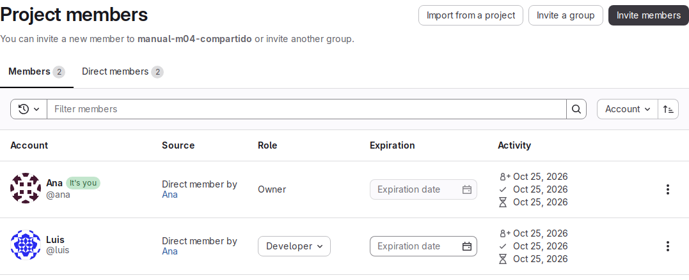
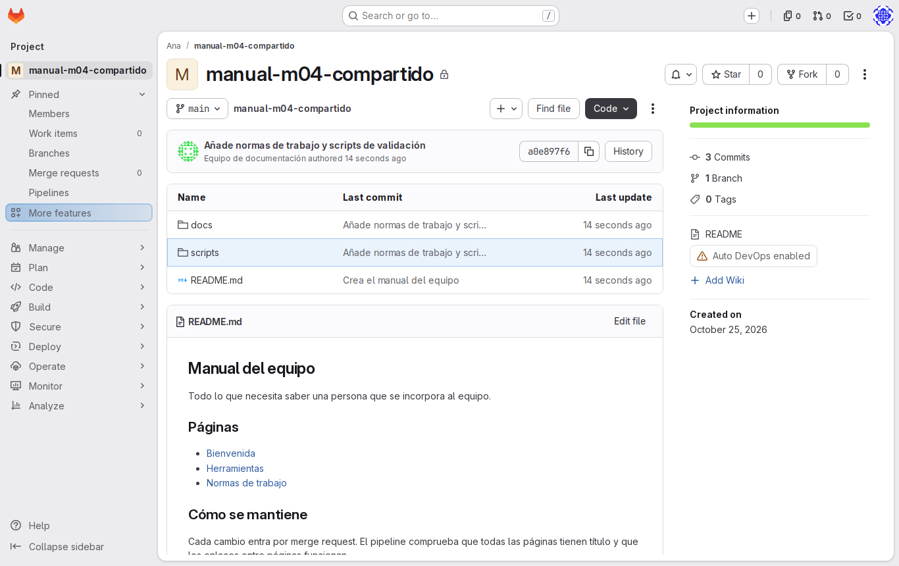
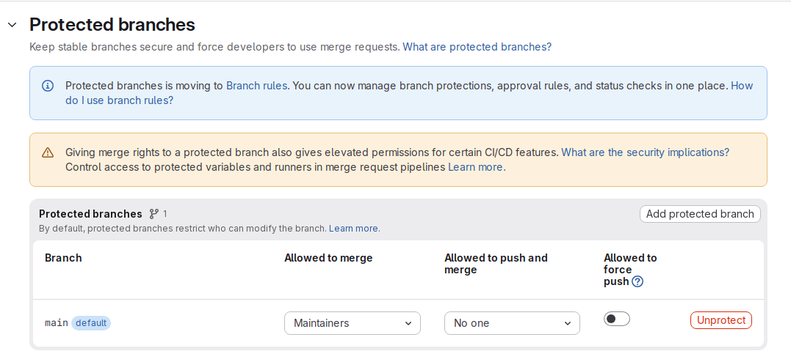
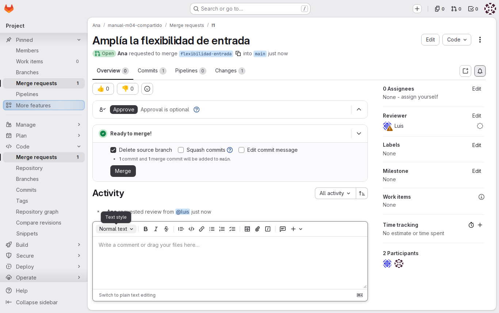
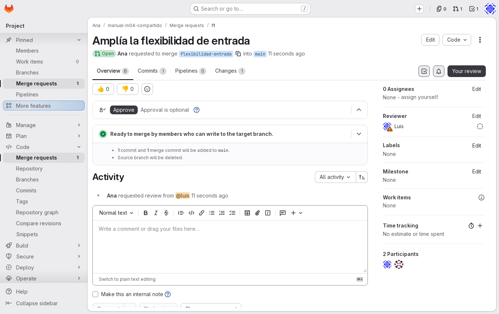

# Lab — Proyecto compartido

[← Página anterior](00-roles-issues-y-mr.md) · [Siguiente página →](02-lab-de-issue-a-mr.md)

El proyecto deja de ser cosa de una sola persona: Luis va a escribir en él con Ana. En este lab, Ana, la dueña del proyecto, le da acceso con el rol justo y protege `main` para que ningún cambio entre en el proyecto sin pasar por una merge request. Haces de las dos personas: cada paso dice si eres Ana o Luis, y en qué ordenador o sesión del navegador.

### Objetivo

`luis` es miembro de `ana/manual-m04-compartido` con rol Developer, y nadie (ni siquiera `ana`) puede hacer push directo a `main`.

### Punto de partida

- El entorno de prácticas levantado ([El entorno de prácticas](../../infra/README.md)): GitLab en `http://localhost:8080`, cuentas `ana` y `luis` con contraseña `Formacion-2026!`.
- Dos sesiones de GitLab abiertas a la vez: **Ana** en una ventana normal del navegador y **Luis** en una ventana privada. Mira el avatar antes de cada paso web.
- Dos pestañas de terminal: en una entras al ordenador de Ana (`docker exec -it pc-ana bash`) y en la otra al de Luis (`docker exec -it pc-luis bash`).
- No hace falta haber hecho ninguna página anterior: el paso 1 crea el proyecto y deja los dos ordenadores con su identidad de Git y su clave SSH.

### En qué consiste

Como Ana, creas el proyecto, invitas a Luis y proteges `main`. Después compruebas que la protección funciona desde los dos lados: un push directo de Ana rechazado y una merge request que Luis no puede fusionar. No se revisa ni se fusiona nada: eso está en [03 — Revisión](03-lab-revision.md).

### 1 — Crea el proyecto de Ana

**Acción:**

```bash
# 🖥️ Terminal del Codespace
scripts/partida.sh ana manual-m04-compartido --preparar luis
```

**Por qué:** deja un `manual-equipo` con historial en el espacio de Ana y una copia en su ordenador. `--preparar luis` deja también el ordenador de Luis con su identidad y su clave, pero **sin** darle acceso al proyecto: eso lo hace Ana en el paso 2.

**Resultado esperado:** el script termina con:

```text
Proyecto: http://localhost:8080/ana/manual-m04-compartido
Copia local: ~/trabajo/manual-m04-compartido en el ordenador de ana (pc-ana)
```

Si algún ordenador aún no tenía identidad o clave, salen además líneas que dicen que se han configurado.

### 2 — Invita a Luis

**Acción** (🌐 GitLab, sesión de Ana):
1. Abre `http://localhost:8080/ana/manual-m04-compartido`.
2. En la barra lateral, ve a **Manage → Members**.
3. Pulsa **Invite members**.
4. En el campo de usuario escribe `luis` y elígelo en la lista.
5. En el desplegable de rol elige **Developer**.
6. Pulsa **Invite**.

**Por qué:** el proyecto es privado; sin ser miembro, Luis ni siquiera lo ve. Developer es el rol de quien escribe en el proyecto: puede crear ramas y abrir merge requests, pero no cambiar la configuración del proyecto.

**Resultado esperado:** en **Manage → Members**, la lista muestra a `ana` (Owner) y a `luis` con el rol **Developer**.



### 3 — Comprueba el acceso de Luis

**Acción** (🌐 GitLab, sesión de Luis): en la ventana privada, abre `http://localhost:8080/ana/manual-m04-compartido`.

**Por qué:** confirmas que la invitación ha llegado a la persona correcta antes de configurar nada más.

**Resultado esperado:** Luis ve el proyecto, con `README.md`, `docs/` y `scripts/`. En la barra lateral no aparece **Settings → Repository**: con rol Developer no puede cambiar la configuración.



Lo que cada uno puede hacer en este proyecto, en resumen:

| Acción en `manual-m04-compartido` | `ana` (Owner) | `luis` (Developer) |
|-----------------------------------|:-------------:|:------------------:|
| Crear issues y ramas, abrir MR | Sí | Sí |
| Push a una rama nueva | Sí | Sí |
| Invitar miembros y proteger ramas | Sí | No |
| Fusionar en `main` (tras el paso 4) | Sí | No |
| Push directo a `main` (tras el paso 4) | No | No |

### 4 — Protege `main`

**Acción** (🌐 GitLab, sesión de Ana):
1. Ve a **Settings → Repository**.
2. Despliega la sección **Protected branches** (botón **Expand**).
3. En la fila de `main`, deja **Allowed to merge** en **Maintainers**.
4. En la misma fila, cambia **Allowed to push and merge** a **No one**.

**Por qué:** GitLab ya protege `main` al crearla, pero deja hacer push a los Maintainers, así que la dueña podría saltarse la revisión. Con **No one**, el único camino a `main` es una merge request, y solo los Maintainers la fusionan.

**Resultado esperado:** la fila de `main` muestra **Allowed to merge: Maintainers** y **Allowed to push and merge: No one**. El cambio se guarda al elegirlo en el desplegable.



> [!WARNING]
> La protección tarda un momento en aplicarse. Si el push del paso siguiente entra, espera un poco y repítelo con otro cambio.

### 5 — Intenta un push directo a `main` desde el ordenador de Ana

**Acción** (📝 VS Code, ordenador de Ana): en `home-ana/trabajo/manual-m04-compartido/docs/normas-de-trabajo.md`, cambia `flexibilidad de una hora` por `flexibilidad de hora y media` y guarda.

**Acción:** súbelo directamente a `main`:

```bash
# 💻 Ordenador de Ana
cd ~/trabajo/manual-m04-compartido
git commit -am "Amplía la flexibilidad de entrada"
git push
```

**Por qué:** es la prueba de que la protección funciona también para quien la puso.

**Resultado esperado:** el commit se crea en el ordenador de Ana, pero GitLab rechaza el push:

```text
[main 4c2e065] Amplía la flexibilidad de entrada
 1 file changed, 1 insertion(+), 1 deletion(-)
```

```text
remote: GitLab: You are not allowed to push code to protected branches on this project.
To gitlab:ana/manual-m04-compartido.git
 ! [remote rejected] main -> main (pre-receive hook declined)
error: failed to push some refs to 'gitlab:ana/manual-m04-compartido.git'
```

En **Code → Commits** de GitLab, el último commit sigue siendo «Añade normas de trabajo y scripts de validación».

### 6 — Lleva el cambio a una rama

**Acción:**

```bash
# 💻 Ordenador de Ana
git switch -c flexibilidad-entrada
git switch main
git reset --hard origin/main
git push -u origin flexibilidad-entrada
```

**Por qué:** el commit rechazado no se pierde: la rama nueva lo conserva, y `main` en el ordenador de Ana vuelve a coincidir con la de GitLab. Así es como entra el trabajo cuando `main` está protegida.

**Resultado esperado:** al volver a `main`, Git avisa de que va un commit por delante (`Your branch is ahead of 'origin/main' by 1 commit.`); el `reset` lo deja como en GitLab (`HEAD is now at …`). El push de la rama entra y GitLab sugiere el enlace para crear la merge request:

```text
 * [new branch]      flexibilidad-entrada -> flexibilidad-entrada
branch 'flexibilidad-entrada' set up to track 'origin/flexibilidad-entrada'.
```

`git status` en `main` dice `Your branch is up to date with 'origin/main'.`

### 7 — Abre la merge request

**Acción** (🌐 GitLab, sesión de Ana):
1. En el proyecto, ve a **Code → Merge requests → New merge request**, con origen `flexibilidad-entrada` y destino `main`, y pulsa **Compare branches and continue**. También vale el enlace que mostró el push, abierto en la ventana de Ana.
2. Deja el título que propone GitLab.
3. Pulsa **Create merge request**.

**Por qué:** es la MR con la que Luis comprobará qué no puede hacer.

**Resultado esperado:** la MR **!1** abierta, con origen `flexibilidad-entrada` y destino `main`. En la pestaña **Overview** de Ana aparece el botón **Merge**.



### 8 — Comprueba que Luis no puede fusionar

**Acción** (🌐 GitLab, sesión de Luis): abre **Code → Merge requests** en `ana/manual-m04-compartido` y entra en la MR !1.

**Por qué:** como Developer, Luis puede leer, comentar y revisar, pero **Allowed to merge: Maintainers** le deja fuera de la fusión. Es lo que garantiza que el cambio lo integra alguien con responsabilidad sobre `main`.

**Resultado esperado:** Luis ve el diff y puede comentar, pero no tiene botón **Merge**: el bloque de fusión indica que solo pueden fusionar los miembros con permiso sobre la rama de destino.



## Comprueba tu entendimiento

**Rol de Luis**
🌐 Sesión de Ana: abre **Manage → Members**.
→ `luis` aparece con rol **Developer**.

**Protección de `main`**
🌐 Sesión de Ana: abre **Settings → Repository → Protected branches**.
→ `main`: **Allowed to merge: Maintainers**, **Allowed to push and merge: No one**.

**Push directo de Luis**
En el ordenador de Luis, clona el proyecto:

```bash
# 💻 Ordenador de Luis
git clone git@gitlab:ana/manual-m04-compartido.git ~/trabajo/manual-m04-compartido
```

En VS Code aparece `home-luis/trabajo/manual-m04-compartido/`: la copia de Luis, distinta de la de Ana. En su `docs/normas-de-trabajo.md`, cambia `dos semanas` por `quince días` y guarda. Después, haz el commit en `main` y súbelo:

```bash
# 💻 Ordenador de Luis
cd ~/trabajo/manual-m04-compartido
git commit -am "Expresa el preaviso de vacaciones en días"
git push
```

→ El clon funciona (Luis ya es miembro) y el push recibe el mismo rechazo que en el paso 5: `You are not allowed to push code to protected branches on this project.`

## Reto

### 1 — Una rama para Luis

Sin cambiar la protección de `main`, consigue que Luis publique su commit del apartado anterior y que llegue a una MR que pueda fusionar Ana.

<details>
<summary>Ver solución</summary>

En el ordenador de Luis, mueve el commit a una rama y súbela:

```bash
# 💻 Ordenador de Luis
git switch -c vacaciones-en-dias
git push -u origin vacaciones-en-dias
```

Las ramas que no son `main` no están protegidas, así que un Developer puede hacer push. Después, en la sesión de Luis, abre la MR desde **Code → Merge requests → New merge request**; en la sesión de Ana se ve con el botón **Merge** y en la de Luis no.

</details>

### 2 — El rol que no basta

¿Qué pasaría si Ana hubiera invitado a Luis como **Reporter**? Compruébalo cambiando su rol en **Manage → Members** (sesión de Ana) y haciendo push de una rama nueva desde el ordenador de Luis.

<details>
<summary>Ver solución</summary>

Un Reporter lee el código y crea issues, pero no puede hacer push a ninguna rama: GitLab rechaza el push con un mensaje de que no tiene permiso para subir código al proyecto. Vuelve a ponerlo como **Developer** al terminar.

</details>

## Errores frecuentes

| Síntoma | Causa probable | Cómo arreglarlo |
|---------|----------------|-----------------|
| `luis` no aparece al invitarlo | El nombre está mal escrito | Escribe exactamente `luis` y espera a que salga en la lista |
| Luis ve «404» al abrir el proyecto | Aún no es miembro, o la ventana privada tiene la sesión de Ana | Revisa **Manage → Members** en la sesión de Ana y el avatar de la ventana privada |
| No ves **Settings → Repository** | Estás en la ventana de Luis (Developer) | La protección la configura Ana: cambia a su ventana |
| El push del paso 5 entra en `main` | La protección aún no se había aplicado, o quedó **Allowed to push and merge: Maintainers** | Revisa la fila de `main`, espera un momento y repite con otro commit |
| `Ya existe ana/manual-m04-compartido en GitLab` | Ya ejecutaste el script con ese nombre | Usa `scripts/partida.sh ana manual-m04-compartido-2 --preparar luis` |
| Tras el paso 6, `git push` en `main` vuelve a fallar | Faltó `git reset --hard origin/main` y el commit sigue en `main` | Ejecútalo en `main` (el commit ya está a salvo en `flexibilidad-entrada`) |
| `git clone` en el ordenador de Luis responde `The project you were looking for could not be found` | Luis aún no es miembro del proyecto | Haz el paso 2 en la sesión de Ana |
