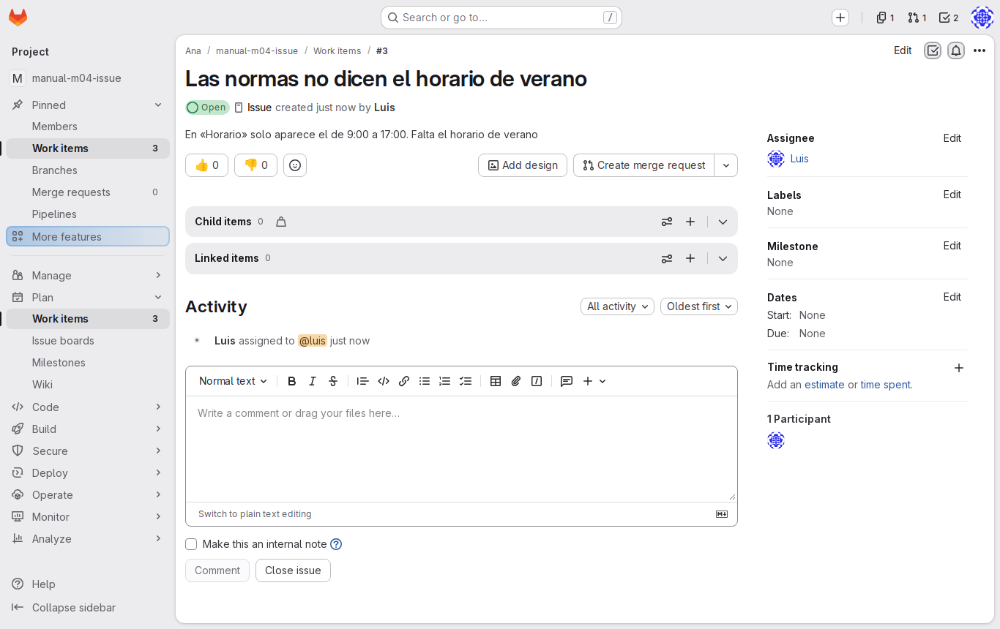
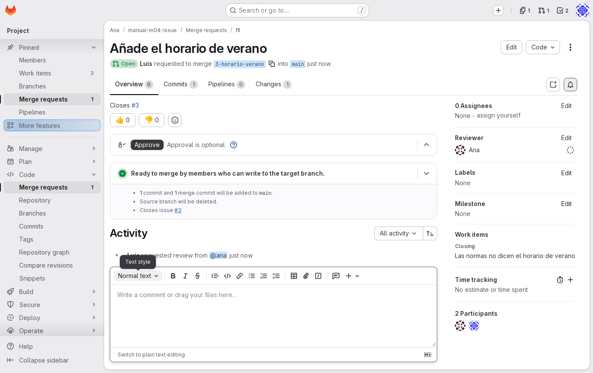
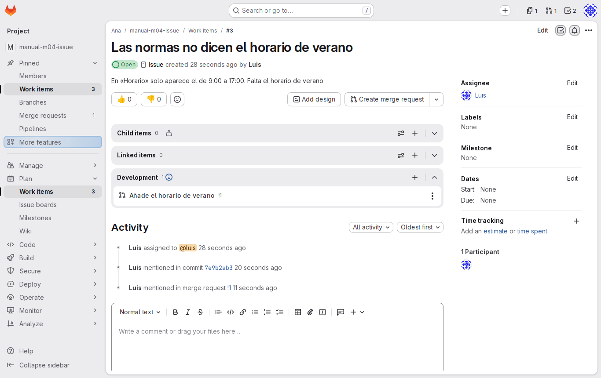

# Lab — De la issue a la merge request

[← Página anterior](01-lab-proyecto-compartido.md) · [Siguiente página →](03-lab-revision.md)

En `docs/normas-de-trabajo.md` el proyecto dice que el horario es de 9:00 a 17:00, pero en verano el equipo tiene otro y nadie lo ha escrito. En este lab, Luis registra el problema como issue, lo arregla en su ordenador en una rama con el número de la issue y abre la merge request que la cerrará. Al final, issue, rama y MR quedan enlazadas entre sí. Haces de Ana y de Luis: cada paso dice quién es y dónde.

### Objetivo

Una issue #3 asignada a Luis, una rama `3-horario-verano` con el cambio y una merge request abierta con `Closes #3`, visibles desde la issue.

### Punto de partida

- El entorno de prácticas levantado ([El entorno de prácticas](../../infra/README.md)): GitLab en `http://localhost:8080`, cuentas `ana` y `luis` con contraseña `Formacion-2026!`.
- Dos sesiones de GitLab: **Ana** en una ventana normal y **Luis** en una ventana privada.
- No hace falta haber hecho ninguna página anterior: el paso 1 prepara el proyecto y los dos ordenadores.

### En qué consiste

Ana prepara el proyecto compartido con dos issues ya registradas; Luis crea la tercera, hace el cambio en su rama y abre la MR. La revisión y la fusión no entran aquí: están en [03 — Revisión](03-lab-revision.md).

### 1 — Prepara el proyecto compartido

**Acción:**

```bash
# 🖥️ Terminal del Codespace
scripts/partida.sh ana manual-m04-issue --miembro luis
```

Después, en GitLab, protege `main`:

**Acción** (🌐 GitLab, sesión de Ana): en `http://localhost:8080/ana/manual-m04-issue`, **Settings → Repository → Protected branches** (**Expand**): en la fila de `main`, **Allowed to push and merge** → **No one** (deja **Allowed to merge** en **Maintainers**).

**Por qué:** el script crea el proyecto de Ana, añade a Luis como Developer y lo clona en los dos ordenadores. Con `main` protegida, el cambio solo puede entrar por merge request, que es lo que vas a practicar. Cómo se invita y se protege paso a paso está en el [Lab — Proyecto compartido](01-lab-proyecto-compartido.md).

**Resultado esperado:** el script termina con:

```text
Proyecto: http://localhost:8080/ana/manual-m04-issue
Copia local: ~/trabajo/manual-m04-issue en el ordenador de ana (pc-ana)
Miembro: luis, con rol Developer
Copia local: ~/trabajo/manual-m04-issue en el ordenador de luis (pc-luis)
```

En GitLab, la fila de `main` muestra **No one** en **Allowed to push and merge**.

### 2 — Registra las issues pendientes del equipo

**Acción** (🌐 GitLab, sesión de Ana): en **Plan → Work items → New item**, crea dos issues, cada una solo con su **Title** y **Create issue**:
1. `La bienvenida no dice dónde pedir el portátil`
2. `Falta el canal del chat del equipo en Herramientas`

**Por qué:** un proyecto vivo siempre tiene trabajo pendiente registrado. Además, así la issue de Luis será la #3, como en el resto de esta página.

**Resultado esperado:** en **Plan → Work items**, dos issues abiertas, **#1** y **#2**.

### 3 — Crea la issue de Luis

**Acción** (🌐 GitLab, sesión de Luis):
1. En la ventana privada, abre `http://localhost:8080/ana/manual-m04-issue` y ve a **Plan → Work items → New item**.
2. **Title:** `Las normas no dicen el horario de verano`.
3. **Description:**

   ```markdown
   En «Horario» solo aparece el de 9:00 a 17:00. Falta el horario de verano
   (del 1 de julio al 31 de agosto, de 8:00 a 15:00).
   ```

4. En **Assignee**, pulsa **assign yourself**.
5. Pulsa **Create issue**.

**Por qué:** la issue deja escrito qué falta y quién se encarga antes de tocar nada. Si mañana alguien pregunta por qué cambió el horario, la respuesta está aquí.

**Resultado esperado:** la issue **#3** abierta, con la descripción y `luis` como asignado en la barra lateral derecha.



> [!TIP]
> Si la issue tiene otro número, usa ese número en lugar de `3` en el resto del lab.

### 4 — Entra en el ordenador de Luis

**Acción:**

```bash
# 🖥️ Terminal del Codespace
docker exec -it pc-luis bash
```

```bash
# 💻 Ordenador de Luis
cd ~/trabajo/manual-m04-issue
```

**Por qué:** el cambio lo hace Luis, con su identidad de Git y su clave SSH, sobre el proyecto de Ana que el script le clonó.

**Resultado esperado:** el prompt `luis@pc-luis:~/trabajo/manual-m04-issue$`. `git remote -v` muestra `git@gitlab:ana/manual-m04-issue.git`.

### 5 — Crea la rama con el número de la issue

**Acción:**

```bash
# 💻 Ordenador de Luis
git switch -c 3-horario-verano
```

**Por qué:** empezar el nombre por `3-` dice a cualquiera, y a GitLab, qué issue resuelve la rama.

**Resultado esperado:**

```text
Switched to a new branch '3-horario-verano'
```

> [!NOTE]
> También se puede crear desde la web: en la issue #3, el desplegable del botón **Create merge request** tiene la opción **Create branch**. GitLab propone un nombre que empieza por `3-` a partir del título. Si la creas así, haz `git fetch` y `git switch` con ese nombre en lugar del comando de arriba.

### 6 — Haz el cambio

**Acción** (📝 VS Code, ordenador de Luis): en `home-luis/trabajo/manual-m04-issue/docs/normas-de-trabajo.md`, en «## Horario», debajo de la línea del horario de referencia, añade una línea en blanco y esta:

```markdown
Del 1 de julio al 31 de agosto, el horario es de 8:00 a 15:00.
```

Guarda y comprueba en el ordenador de Luis (💻) con `git diff`.

**Por qué:** es justo lo que pide la issue, y nada más: una MR pequeña se revisa mejor. La ruta empieza por `home-luis/`: es la copia de Luis, no la de Ana.

**Resultado esperado:**

```diff
@@ -4,6 +4,8 @@
 
 El horario de referencia es de 9:00 a 17:00, con flexibilidad de una hora a la entrada.
 
+Del 1 de julio al 31 de agosto, el horario es de 8:00 a 15:00.
+
 ## Reuniones
```

### 7 — Registra el commit

**Acción:**

```bash
# 💻 Ordenador de Luis
git add docs/normas-de-trabajo.md
git commit -m "Añade el horario de verano (#3)"
```

**Por qué:** `#3` en el mensaje enlaza el commit con la issue: desde GitLab se llega de uno a otro. El commit lleva la firma de Luis, configurada en su ordenador.

**Resultado esperado:**

```text
[3-horario-verano e5bf0b1] Añade el horario de verano (#3)
 1 file changed, 2 insertions(+)
```

### 8 — Publica la rama

**Acción:**

```bash
# 💻 Ordenador de Luis
git push -u origin 3-horario-verano
```

**Por qué:** `main` está protegida, pero las demás ramas no: como Developer, Luis puede subir la suya.

**Resultado esperado:** la rama se crea en GitLab y la respuesta trae el enlace para abrir la merge request:

```text
remote:
remote: To create a merge request for 3-horario-verano, visit:
remote:   http://localhost:8080/ana/manual-m04-issue/-/merge_requests/new?merge_request%5Bsource_branch%5D=3-horario-verano
remote:
To gitlab:ana/manual-m04-issue.git
 * [new branch]      3-horario-verano -> 3-horario-verano
branch '3-horario-verano' set up to track 'origin/3-horario-verano'.
```

### 9 — Abre la merge request

**Acción** (🌐 GitLab, sesión de Luis):
1. Copia el enlace del push y ábrelo en la **ventana privada** de Luis (en la de Ana, la MR quedaría a nombre de Ana).
2. Comprueba que el origen es `3-horario-verano` y el destino `main`.
3. **Title:** `Añade el horario de verano`.
4. **Description:** asegúrate de que contiene la línea `Closes #3` (GitLab puede haberla puesto ya por el nombre de la rama).
5. En **Reviewer**, elige a `ana`.
6. Deja marcada **Delete source branch when merge request is accepted.**
7. Pulsa **Create merge request**.

**Por qué:** la MR es la propuesta formal de que el cambio entre en `main`. `Closes #3` hace que la issue se cierre sola al fusionar, y Ana sabe que le toca revisar.

**Resultado esperado:** la MR **!1** abierta por `luis`, con origen `3-horario-verano`, destino `main`, `ana` como revisora y, en la descripción, `Closes #3` convertido en enlace a la issue.



### 10 — Recorre la relación issue ↔ rama ↔ MR

**Acción** (🌐 GitLab, sesión de Luis):
1. Abre la issue #3 (**Plan → Work items**).
2. Busca la MR relacionada en el cuerpo de la issue y en su actividad.
3. Desde la MR, pulsa la pestaña **Commits** y luego **Code → Branches**.

**Por qué:** en un equipo, la pregunta «¿en qué va esto?» se responde desde la issue: ahí está la MR, y desde la MR, la rama y sus commits.

**Resultado esperado:** la issue #3 muestra la MR !1 como relacionada y, en la actividad, que la mencionó el commit o la MR. La MR muestra el commit `Añade el horario de verano (#3)`, de Luis. En **Code → Branches** aparece `3-horario-verano` junto a `main`.



## Comprueba tu entendimiento

**La issue sigue abierta**
🌐 Sesión de Ana: abre **Plan → Work items**.
→ La #3 sigue **Open**: no se cierra hasta que se fusione la MR.

**Qué cambia la MR**
🌐 Sesión de Ana: abre la MR !1 y la pestaña **Changes**.
→ Un fichero, `docs/normas-de-trabajo.md`, con dos líneas añadidas.

**main intacta en el ordenador de Ana**
En el ordenador de Ana, `cd ~/trabajo/manual-m04-issue && git pull`; después abre en VS Code `home-ana/trabajo/manual-m04-issue/docs/normas-de-trabajo.md`.
→ `git pull` no trae nada nuevo a `main` y el archivo de Ana no tiene el horario de verano: solo está en la rama de Luis.

## Reto

### 1 — Una rama desde la propia issue

Toma la issue #2 («Falta el canal del chat del equipo en Herramientas») y resuélvela sin crear la rama a mano: crea la rama y la MR desde la propia issue y haz el cambio en la web.

<details>
<summary>Ver solución</summary>

En la sesión de Luis, en la issue #2, pulsa **Create merge request**. GitLab crea una rama que empieza por `2-` y una MR en borrador que ya cierra la #2. Edita `docs/herramientas.md` en esa rama (por ejemplo, con **Code → Repository**, eligiendo la rama y **Edit**), añade el canal a la fila «Chat del equipo» y guarda el commit en esa misma rama. La MR muestra el cambio en **Changes**.

</details>

## Errores frecuentes

| Síntoma | Causa probable | Cómo arreglarlo |
|---------|----------------|-----------------|
| La issue o la MR aparecen creadas por `ana` | Se hizo en la ventana normal, que tiene la sesión de Ana | Mira el avatar; ciérrala y créala en la ventana privada de Luis |
| `git@gitlab: Permission denied (publickey).` en el ordenador de Luis | Su clave no está registrada | Vuelve a ejecutar el paso 1 con otro nombre de proyecto, o regístrala como en el [lab de identidad y acceso](../M01-introduccion-git-gitlab/01-lab-identidad-y-acceso.md) |
| `You are not allowed to push code to protected branches` | El commit se hizo en `main` en vez de en la rama | `git switch -c 3-horario-verano` (el commit viaja con la rama) y vuelve a hacer push de la rama |
| La issue no se enlaza con la MR | En la descripción falta `Closes #3` o tiene otro número | Edita la MR y añade `Closes #3` con el número real de la issue |
| La issue de Luis no es la #3 | No se crearon las dos issues del paso 2, o se crearon más | Usa el número real en la rama, el commit y `Closes` |
