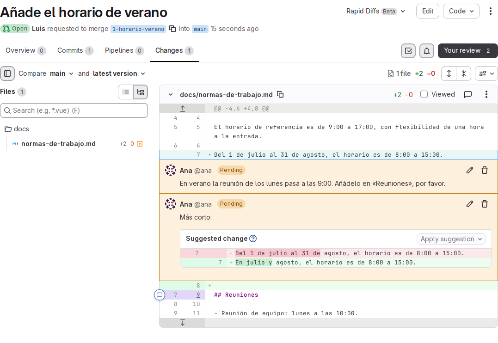
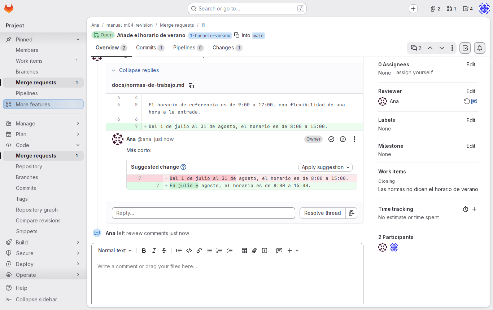
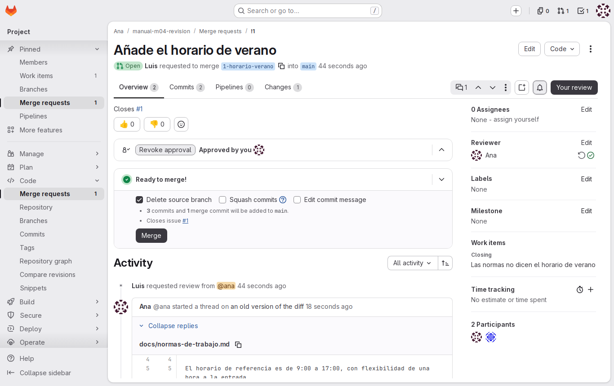

# Lab — Revisión

[← Página anterior](02-lab-de-issue-a-mr.md) · [Siguiente página →](../M05-gitlab-ci-cd/README.md)

Luis ha propuesto en una merge request el horario de verano del proyecto. Antes de que entre en `main`, Ana lo revisa: comenta una línea, propone una redacción con una sugerencia de cambio y, cuando Luis lo ha corregido, aprueba y fusiona. La issue se cierra sola y la rama desaparece. Haces de los dos: cada paso dice si eres Ana o Luis, y en qué ordenador o ventana del navegador.

### Objetivo

La MR de Luis revisada por Ana con un comentario y una sugerencia, corregida, fusionada en `main`, con su issue cerrada y su rama borrada.

### Punto de partida

- El entorno de prácticas levantado ([El entorno de prácticas](../../infra/README.md)): GitLab en `http://localhost:8080`, cuentas `ana` y `luis` con contraseña `Formacion-2026!`.
- Dos sesiones de GitLab: **Ana** en una ventana normal y **Luis** en una ventana privada.
- No hace falta haber hecho ninguna página anterior: los pasos 1 y 2 preparan el proyecto y la MR.

### En qué consiste

Preparas un proyecto compartido con una MR abierta de Luis (pasos 1 y 2) y haces su revisión completa hasta la fusión. Para practicar la creación de la issue y la MR con calma, está [02 — De la issue a la merge request](02-lab-de-issue-a-mr.md).

### 1 — Prepara el proyecto compartido

**Acción:**

```bash
# 🖥️ Terminal del Codespace
scripts/partida.sh ana manual-m04-revision --miembro luis
```

**Acción** (🌐 GitLab, sesión de Ana): en `http://localhost:8080/ana/manual-m04-revision`, **Settings → Repository → Protected branches** (**Expand**): en la fila de `main`, **Allowed to push and merge** → **No one** (deja **Allowed to merge** en **Maintainers**).

**Por qué:** el script crea el proyecto de Ana, añade a Luis como Developer y lo clona en los dos ordenadores. Con `main` protegida solo se integra lo que pasa por revisión.

**Resultado esperado:** el script termina con `Miembro: luis, con rol Developer` y `Copia local: ~/trabajo/manual-m04-revision en el ordenador de luis (pc-luis)`. En GitLab, `main` tiene **No one** en **Allowed to push and merge**.

### 2 — Luis abre la MR que se va a revisar

**Acción** (🌐 GitLab, sesión de Luis): en el proyecto, **Plan → Work items → New item**: **Title** `Las normas no dicen el horario de verano`, en **Assignee**, **assign yourself**; **Create issue**. Será la **#1**.

**Acción** (💻 Ordenador de Luis): entra con `docker exec -it pc-luis bash` y crea la rama:

```bash
# 💻 Ordenador de Luis
cd ~/trabajo/manual-m04-revision
git switch -c 1-horario-verano
```

**Acción** (📝 VS Code, ordenador de Luis): en `home-luis/trabajo/manual-m04-revision/docs/normas-de-trabajo.md`, debajo de la línea «El horario de referencia es de 9:00 a 17:00…», añade una línea en blanco y `Del 1 de julio al 31 de agosto, el horario es de 8:00 a 15:00.` Guarda.

**Acción** (💻 Ordenador de Luis): registra y publica:

```bash
# 💻 Ordenador de Luis
git commit -am "Añade el horario de verano (#1)"
git push -u origin 1-horario-verano
```

**Acción** (🌐 GitLab, sesión de Luis): abre el enlace del push en la ventana privada y crea la MR: **Title** `Añade el horario de verano`, **Description** con la línea `Closes #1`, **Reviewer** `ana`, **Delete source branch when merge request is accepted.** marcada, **Create merge request**.

**Por qué:** es el estado que encuentra una revisora cada día: una MR pequeña, enlazada a su issue y asignada a ella.

**Resultado esperado:** la MR **!1** abierta por `luis`, de `1-horario-verano` a `main`, con `ana` como revisora y `Closes #1` en la descripción.

### 3 — Lee los cambios

**Acción** (🌐 GitLab, sesión de Ana):
1. Abre **Code → Merge requests** y entra en la MR !1.
2. Pulsa la pestaña **Changes**.

**Por qué:** se revisa lo que cambia, no el fichero entero. El diff enseña exactamente qué entraría en `main`.

**Resultado esperado:** un fichero, `docs/normas-de-trabajo.md`, con dos líneas añadidas en verde: una en blanco y `Del 1 de julio al 31 de agosto, el horario es de 8:00 a 15:00.`

### 4 — Comenta una línea

**Acción** (🌐 GitLab, sesión de Ana):
1. Pasa el ratón por la línea añadida «Del 1 de julio…» y pulsa el icono de comentario que aparece a su izquierda.
2. Escribe:

   ```markdown
   En verano la reunión de los lunes pasa a las 9:00. Añádelo en «Reuniones», por favor.
   ```

3. Pulsa **Start a review**.

**Por qué:** el comentario queda pegado a la línea que lo motiva, no perdido en un chat. Con **Start a review**, los comentarios de Ana se guardan como pendientes y Luis los recibe todos juntos, no uno a uno.

**Resultado esperado:** el comentario aparece bajo la línea marcado como pendiente, y GitLab muestra una revisión en curso con 1 comentario.

### 5 — Propón una redacción con una sugerencia

**Acción** (🌐 GitLab, sesión de Ana):
1. En la misma línea, abre otro comentario.
2. Pulsa el botón **Insert suggestion** de la barra del editor (o escribe el bloque a mano). Deja el bloque así:

   ````markdown
   Más corto:

   ```suggestion
   En julio y agosto, el horario es de 8:00 a 15:00.
   ```
   ````

3. Pulsa **Add to review**.

**Por qué:** cuando la revisora sabe cómo debería quedar, una sugerencia ahorra la ida y vuelta: Luis la aplica con un clic, sin reescribir nada.

**Resultado esperado:** la vista previa muestra un mini-diff: en rojo la línea actual, en verde la propuesta. La revisión pendiente tiene ahora 2 comentarios.



### 6 — Envía la revisión

**Acción** (🌐 GitLab, sesión de Ana):
1. Pulsa **Your review**: se abre el panel **Submit your review**.
2. En **Review approval**, deja **Comment**: Ana todavía no aprueba, pide cambios.
3. Pulsa **Submit review**.

**Por qué:** hasta ahora nadie veía los comentarios de Ana. Al enviarlos, Luis recibe la revisión completa de una vez.

**Resultado esperado:** los dos comentarios dejan de estar pendientes y aparecen también en la pestaña **Overview**, cada uno como un hilo sin resolver.

### 7 — Aplica la sugerencia

**Acción** (🌐 GitLab, sesión de Luis):
1. Recarga la MR !1 en la ventana privada, pestaña **Overview** o **Changes**.
2. En el hilo de la sugerencia, pulsa **Apply suggestion**.
3. Deja el mensaje de commit que propone GitLab y confirma con **Apply**.

**Por qué:** el cambio que proponía Ana entra en la rama de Luis como un commit, sin editar el fichero.

**Resultado esperado:** el hilo de la sugerencia queda resuelto y en la pestaña **Commits** aparece un segundo commit, hecho desde la web, sobre la rama `1-horario-verano`.



### 8 — Trae el commit de la sugerencia

**Acción:**

```bash
# 💻 Ordenador de Luis
git pull
```

**Por qué:** el commit de la sugerencia solo existe en GitLab. Si Luis no lo trae primero, su próximo push sería rechazado.

**Resultado esperado:**

```text
Updating 99f6670..7883163
Fast-forward
 docs/normas-de-trabajo.md | 2 +-
 1 file changed, 1 insertion(+), 1 deletion(-)
```

(Los identificadores de commit serán otros.) En VS Code, `home-luis/trabajo/manual-m04-revision/docs/normas-de-trabajo.md` ya dice `En julio y agosto, el horario es de 8:00 a 15:00.`: el `pull` ha cambiado el archivo en el ordenador de Luis.

### 9 — Responde al comentario con un commit

**Acción** (📝 VS Code, ordenador de Luis): en `home-luis/trabajo/manual-m04-revision/docs/normas-de-trabajo.md`, cambia la línea de la reunión de equipo para que diga:

```markdown
- Reunión de equipo: lunes a las 10:00 (en julio y agosto, a las 9:00).
```

Guarda y publica desde el ordenador de Luis:

```bash
# 💻 Ordenador de Luis
git commit -am "Indica la hora de la reunión en verano (#1)"
git push
```

**Por qué:** este comentario no traía sugerencia, así que el cambio lo hace Luis. Al subirlo a la misma rama, la MR se actualiza sola: no hay que abrir otra.

**Resultado esperado:**

```text
[1-horario-verano a8ee575] Indica la hora de la reunión en verano (#1)
 1 file changed, 1 insertion(+), 1 deletion(-)
```

```text
To gitlab:ana/manual-m04-revision.git
   7883163..a8ee575  1-horario-verano -> 1-horario-verano
```

**Acción** (🌐 GitLab, sesión de Luis): en la MR aparece el tercer commit. Responde al hilo del comentario con «Hecho» y pulsa **Resolve thread**.

### 10 — Aprueba la MR

**Acción** (🌐 GitLab, sesión de Ana):
1. Recarga la MR !1 y, en la pestaña **Changes**, comprueba los dos cambios nuevos.
2. En **Overview**, pulsa **Approve**.

**Por qué:** la aprobación deja constancia de que alguien distinto del autor ha revisado el cambio. En GitLab Free es opcional: no bloquea la fusión, pero queda registrada.

**Resultado esperado:** la MR indica que la ha aprobado Ana (`Approved by` con su avatar).



> [!NOTE]
> Si no ves el botón **Approve**, deja un comentario «Revisado, lo fusiono» y sigue con el paso siguiente.

### 11 — Fusiona

**Acción** (🌐 GitLab, sesión de Ana):
1. En **Overview**, comprueba que la casilla **Delete source branch** está marcada.
2. Pulsa **Merge**.

**Por qué:** como Owner del proyecto, Ana es de las pocas personas que pueden fusionar en `main`. Borrar la rama al fusionar deja el proyecto limpio: su trabajo ya está en `main`.

**Resultado esperado:** la MR pasa a **Merged**. En **Code → Repository**, `docs/normas-de-trabajo.md` en `main` muestra el horario de verano y la reunión de verano. En **Code → Branches** ya no aparece `1-horario-verano`.

### 12 — Comprueba la issue

**Acción** (🌐 GitLab, sesión de Ana o de Luis): abre **Plan → Work items** y busca la #1 (pestaña **Closed**).

**Por qué:** gracias a `Closes #1`, nadie tiene que acordarse de cerrar la issue: se cierra cuando el cambio entra de verdad en `main`.

**Resultado esperado:** la issue #1 está **Closed**, y en su actividad se indica que se cerró con la merge request !1.

### 13 — Pon al día el ordenador de Luis

**Acción:**

```bash
# 💻 Ordenador de Luis
git switch main
git pull
git branch -d 1-horario-verano
git fetch --prune
```

**Por qué:** el `main` del ordenador de Luis aún no tiene la fusión, y su rama local ya no sirve: el trabajo está en `main` y la rama de GitLab se borró.

**Resultado esperado:** `git pull` termina en `Fast-forward`, `git branch -d` dice `Deleted branch 1-horario-verano (was …).` y `git fetch --prune` muestra `- [deleted]         (none)     -> origin/1-horario-verano`.

## Comprueba tu entendimiento

**Historia de la revisión**
🌐 Cualquiera de las dos sesiones: abre la MR !1, pestaña **Overview**.
→ Los dos hilos resueltos, la aprobación de Ana, los tres commits y la fusión.

**Quién cambió qué**
En el ordenador de Luis, en `main`: `git log --format='%h %an %s' -4`.
→ El commit de fusión `Merge branch '1-horario-verano' into 'main'` (de Ana, que fusionó) y, debajo, los dos commits de Luis y el de la sugerencia.

**El autor no fusiona**
🌐 Sesión de Luis: abre otra MR suya (o una nueva desde cualquier rama).
→ No tiene botón **Merge**: en este proyecto solo fusionan los Maintainers y la Owner.

## Reto

### 1 — Revisión al revés

Cambia los papeles: Ana crea una issue (por ejemplo, «Las vacaciones no dicen dónde se registran»), la resuelve en su ordenador en una rama `2-…` y abre la MR con `Closes #2`; Luis la revisa con una sugerencia. ¿Puede Luis fusionarla?

<details>
<summary>Ver solución</summary>

Luis puede comentar, sugerir y aprobar; la sugerencia la aplica Ana, autora de la MR. Pero **no** puede fusionar: **Allowed to merge** es **Maintainers** y Luis es Developer. La fusiona Ana tras la aprobación de Luis. Revisar no es lo mismo que tener permiso para integrar.

</details>

## Errores frecuentes

| Síntoma | Causa probable | Cómo arreglarlo |
|---------|----------------|-----------------|
| Luis no ve los comentarios de Ana | Ana no ha enviado la revisión: siguen pendientes | En la sesión de Ana, **Your review** → **Submit review** |
| La MR o la revisión salen a nombre de la otra persona | Se hizo en la ventana equivocada | Mira el avatar: Ana en la ventana normal, Luis en la privada |
| No aparece **Apply suggestion** | El comentario no tiene un bloque `suggestion`, o se escribió con otra marca | Edita el comentario: tres comillas invertidas seguidas de `suggestion` |
| El push del paso 9 es rechazado (`! [rejected] … (fetch first)`) | Faltó el `git pull` tras aplicar la sugerencia | `git pull` y repite el push |
| No ves el botón **Merge** | Estás en la sesión de Luis, o quedan hilos sin resolver si el proyecto lo exige | Fusiona en la sesión de Ana; resuelve los hilos |
| La issue sigue abierta tras fusionar | La descripción de la MR no tenía `Closes #1` o tenía otro número | Ciérrala a mano desde la issue y revisa la descripción la próxima vez |
| `git branch -d` dice `not fully merged` | Faltó `git pull` en `main` antes | `git switch main`, `git pull` y repite |
