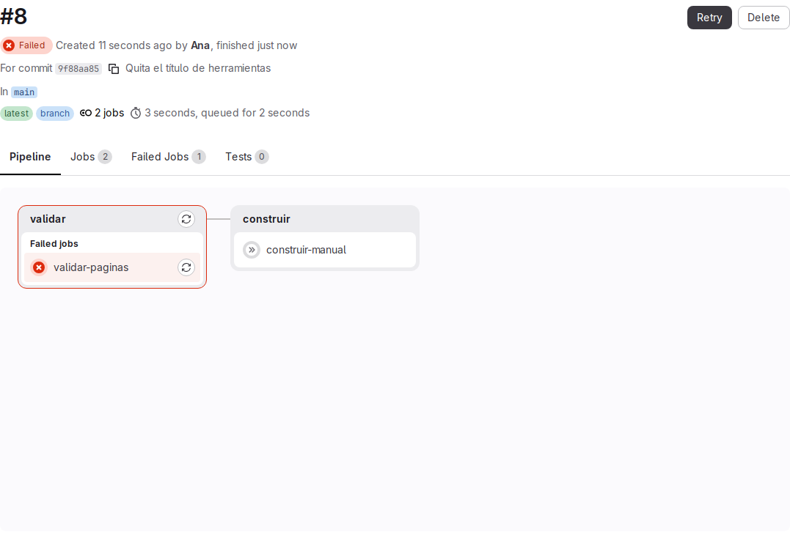

# Lab — Fallo controlado

[← Página anterior](02-lab-artefacto.md) · [Siguiente página →](../M06-flujo-completo/README.md)

Un pipeline sirve sobre todo el día que falla: frena el cambio antes de que llegue al proyecto. En este lab rompes a propósito una página de `manual-equipo`, ves cómo el pipeline se pone en rojo, encuentras en el log la línea que explica el fallo, lo reproduces en el ordenador de Ana y lo corriges.

### Objetivo

Diagnosticar por el log un job fallido, reproducir el error en local y dejar el pipeline otra vez en **Passed**.

### Punto de partida

- El entorno de prácticas levantado ([El entorno de prácticas](../../infra/README.md)): GitLab en `http://localhost:8080` y su runner.
- Estado: en el terminal del Codespace, ejecuta:

  ```bash
  # 🖥️ Terminal del Codespace
  scripts/partida.sh ana manual-m05-fallo --con-ci
  docker exec -it pc-ana bash
  ```

  Crea `ana/manual-m05-fallo` con el contenido del proyecto y el `.gitlab-ci.yml` (jobs `validar-paginas` y `construir-manual`), y lo clona en `~/trabajo/manual-m05-fallo` del ordenador de Ana. El push inicial lanza un pipeline que debe acabar en **Passed**: compruébalo en **Build → Pipelines** antes de empezar. El segundo comando te sienta en el ordenador de Ana.

### En qué consiste

Quitas el título de `docs/herramientas.md`, publicas, lees el fallo en GitLab, lo reproduces con `sh scripts/validar.sh`, restauras el título y publicas la corrección. No tocas el `.gitlab-ci.yml`.

### 1 — Quita el título de la página de herramientas

**Acción** (💻 Ordenador de Ana):

```bash
# 💻 Ordenador de Ana
cd ~/trabajo/manual-m05-fallo
```

**Acción** (📝 VS Code, ordenador de Ana): en `home-ana/trabajo/manual-m05-fallo/docs/herramientas.md`, borra la primera línea, `# Herramientas`, y guarda.

**Por qué:** es el error más fácil de cometer al editar una página: el script de validación exige que la primera línea con texto empiece por `# `.

**Resultado esperado:** `git diff` muestra la línea borrada:

```text
--- a/docs/herramientas.md
+++ b/docs/herramientas.md
@@ -1,4 +1,3 @@
-# Herramientas
 
 | Herramienta | Para qué | Cómo pedir acceso |
 |-------------|----------|-------------------|
```

### 2 — Publica el cambio sin validar

**Acción** (💻 Ordenador de Ana):

```bash
# 💻 Ordenador de Ana
git commit -am "Quita el título de herramientas"
git push
```

**Por qué:** simulas a alguien que publica sin ejecutar la validación en su ordenador. Es justo el caso que el pipeline debe atrapar.

**Resultado esperado:** `1 file changed, 1 deletion(-)` en el commit y `main -> main` en el push. Git no se queja: no sabe nada de títulos.

### 3 — Mira el pipeline en rojo

**Acción** (🌐 GitLab, sesión de Ana): abre **Build → Pipelines** y haz clic en el pipeline del commit «Quita el título de herramientas».

**Por qué:** el grafo dice en qué stage se ha parado y qué se ha dejado de hacer.

**Resultado esperado:** el pipeline en **Failed**. En la columna `validar`, `validar-paginas` en **Failed**; en `construir`, `construir-manual` en **Skipped**: con una página rota no se genera el proyecto.



### 4 — Lee el log del job fallido

**Acción** (🌐 GitLab, sesión de Ana): haz clic en `validar-paginas` y ve al final del log.

**Por qué:** el estado dice *que* ha fallado; el log dice *por qué*. Las líneas del principio (runner, imagen, clonado) son las mismas de un job correcto: lo que importa está tras el comando `$`.

**Resultado esperado:**

```text
$ sh scripts/validar.sh
revisado README.md
revisado docs/bienvenida.md
ERROR docs/herramientas.md: falta el título (la primera línea debe empezar por '# ')
revisado docs/herramientas.md
revisado docs/normas-de-trabajo.md
1 error(es)
Cleaning up project directory and file based variables
ERROR: Job failed: exit code 1
```

(Log real recortado: se omiten las líneas de preparación del runner.)

### 5 — Distingue las dos líneas `ERROR`

**Acción** (🌐 GitLab, sesión de Ana): en el log, localiza las dos líneas que empiezan por `ERROR`.

**Por qué:** no dicen lo mismo y conviene no confundirlas cuando un log es largo.

**Resultado esperado:**

| Línea | Quién la escribe | Qué dice |
|-------|------------------|----------|
| `ERROR docs/herramientas.md: falta el título …` | `scripts/validar.sh` | La causa: qué archivo y qué regla |
| `ERROR: Job failed: exit code 1` | El runner | La consecuencia: el script terminó con código distinto de 0 y el job falla |

La primera es la que te dice qué arreglar.

### 6 — Reproduce el fallo en local

**Acción** (💻 Ordenador de Ana): `sh scripts/validar.sh`

**Por qué:** si el error aparece en el ordenador de Ana, se puede corregir y comprobarlo sin hacer un push por cada intento.

**Resultado esperado:** la misma salida que en el log:

```text
revisado README.md
revisado docs/bienvenida.md
ERROR docs/herramientas.md: falta el título (la primera línea debe empezar por '# ')
revisado docs/herramientas.md
revisado docs/normas-de-trabajo.md
1 error(es)
```

### 7 — Restaura el título

**Acción** (📝 VS Code, ordenador de Ana): en `home-ana/trabajo/manual-m05-fallo/docs/herramientas.md`, vuelve a escribir `# Herramientas` como primera línea y guarda. Después, en el ordenador de Ana (💻), ejecuta otra vez `sh scripts/validar.sh`.

**Por qué:** corriges y compruebas en local antes de publicar.

**Resultado esperado:**

```text
revisado README.md
revisado docs/bienvenida.md
revisado docs/herramientas.md
revisado docs/normas-de-trabajo.md
Todas las páginas son correctas
```

### 8 — Publica la corrección

**Acción** (💻 Ordenador de Ana):

```bash
# 💻 Ordenador de Ana
git commit -am "Restaura el título de herramientas"
git push
```

**Por qué:** el pipeline en rojo sigue ahí; solo un commit nuevo lanza un pipeline que demuestre que está arreglado.

**Resultado esperado:** en **Build → Pipelines**, un pipeline nuevo en **Passed**, con `validar-paginas` y `construir-manual` en verde. El fallido sigue en la lista: el historial de pipelines no se borra.

## Comprueba tu entendimiento

**Un enlace roto también para el pipeline**
En VS Code, en `home-ana/trabajo/manual-m05-fallo/docs/bienvenida.md`, cambia `(herramientas.md)` por `(herramienta.md)` y guarda; después, en el ordenador de Ana, ejecuta `sh scripts/validar.sh`.
→ Aparece una línea `ERROR docs/bienvenida.md: enlace roto a herramienta.md` y el script termina con `1 error(es)`. Deshaz el cambio con `git restore docs/bienvenida.md`.

**Dónde está la causa**
En el log del pipeline fallido, busca la primera línea que empieza por `ERROR`.
→ Es la del script y nombra el archivo; la del runner, `ERROR: Job failed: exit code 1`, es siempre la última.

## Reto

### 1 — Dos errores de una vez

Publica un commit que quite el título de `docs/normas-de-trabajo.md` y, a la vez, rompa el enlace a `bienvenida.md` en `docs/herramientas.md`. Antes de mirar GitLab, di qué contará el log y en qué estado quedará cada job. Después corrígelo.

<details>
<summary>Ver solución</summary>

El log de `validar-paginas` tendrá dos líneas del script: `ERROR docs/herramientas.md: enlace roto a …` y `ERROR docs/normas-de-trabajo.md: falta el título (la primera línea debe empezar por '# ')`, y terminará con `2 error(es)` y `ERROR: Job failed: exit code 1`. El script no se detiene en el primer error: revisa todas las páginas y cuenta. `validar-paginas` queda en **Failed** y `construir-manual` en **Skipped**. Para corregirlo, restaura las dos líneas, comprueba con `sh scripts/validar.sh` que dice `Todas las páginas son correctas` y publica.

</details>

## Errores frecuentes

| Síntoma | Causa probable | Cómo arreglarlo |
|---------|----------------|-----------------|
| El job se queda en **Pending** y no llega a ejecutarse | No hay ningún runner disponible para el proyecto | Mira **Settings → CI/CD → Runners**; si no hay ninguno activo, ejecuta `infra/bootstrap.sh` en el terminal del Codespace. No es un fallo del cambio |
| El pipeline aparece fallido sin ningún job y GitLab lo marca como YAML inválido | Se tocó el `.gitlab-ci.yml` y la sangría o la sintaxis no son correctas | Abre **Build → Pipeline editor**, que señala la línea del problema; corrige y vuelve a publicar |
| El log es muy largo y no encuentras el error | Las líneas de preparación del runner ocupan la mayor parte | Ve al final del log y sube hasta la línea que empieza por `$`; el error está debajo |
| En local dice `Todas las páginas son correctas`, pero el pipeline falla | No has hecho commit de lo que corregiste, o no has hecho push | `git status` y `git log origin/main --oneline -1`: el commit corregido tiene que estar en GitLab |
| Tras corregir, el pipeline fallido sigue en rojo | Cada pipeline corresponde a un commit; el antiguo no cambia | Mira el pipeline más reciente, el del commit de corrección |
