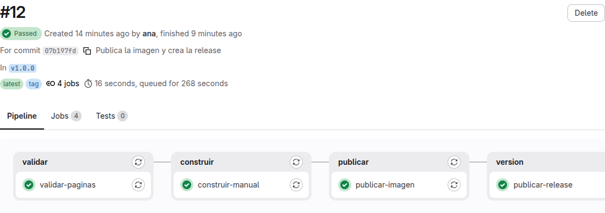
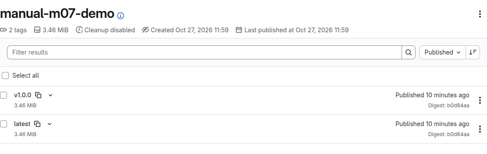
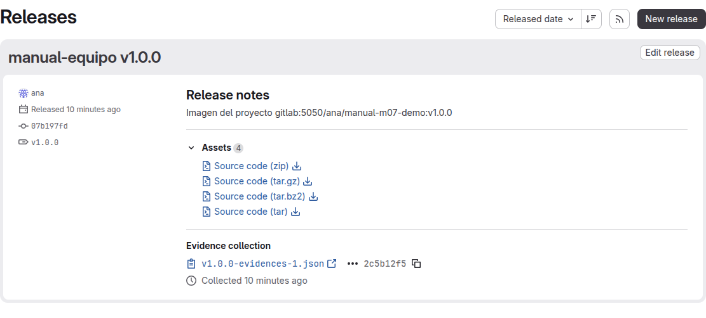

# De la imagen a la release

[← Página anterior](README.md) · [Siguiente página →](01-lab-imagen.md)

El pipeline de `manual-equipo` ya sabe comprobar las páginas y juntarlas en `public/manual-completo.md`. Esta demostración recorre el paso siguiente: ese documento viaja dentro de una imagen Docker, y el tag `v1.0.0` deja en GitLab la ficha de esa versión.

## Punto de partida

- El entorno de prácticas levantado ([El entorno de prácticas](../../infra/README.md)): GitLab en `http://localhost:8080`, registro en `gitlab:5050` y su runner.
- Proyecto `ana/manual-m07-demo`, creado con:

  ```bash
  # 🖥️ Terminal del Codespace
  scripts/partida.sh ana manual-m07-demo --con-publicacion
  ```

  Tiene el proyecto, el `Dockerfile`, el `.gitlab-ci.yml` con las stages `validar`, `construir`, `publicar` y `version`, y el tag `v1.0.0` sobre `main`. El script lanza el pipeline de esa etiqueta. Copia en `~/trabajo/manual-m07-demo` del ordenador de Ana.

## Recorrido

### La imagen

1. En la raíz del repositorio está el `Dockerfile`. Copia el documento generado y, al ejecutar la imagen, lo imprime:

```dockerfile
FROM alpine:3.20
COPY public/manual-completo.md /manual/manual-completo.md
CMD ["cat", "/manual/manual-completo.md"]
```

`public/manual-completo.md` no está en el repositorio. Lo produce el job `construir-manual` y el siguiente job lo encuentra ya en el directorio, porque GitLab le pasa el artefacto de la stage anterior.

2. El job que publica, en `.gitlab-ci.yml`, construye la imagen y la sube al registro del proyecto. En un pipeline de tag sube también la etiqueta con el nombre del tag:

```yaml
publicar-imagen:
  stage: publicar
  image:
    name: docker:27-cli
    entrypoint: [""]
  script:
    - docker login -u "$CI_REGISTRY_USER" -p "$CI_REGISTRY_PASSWORD" "$CI_REGISTRY"
    - docker build -t "$CI_REGISTRY_IMAGE:latest" .
    - docker push "$CI_REGISTRY_IMAGE:latest"
    - |
      if [ -n "$CI_COMMIT_TAG" ]; then
        docker tag "$CI_REGISTRY_IMAGE:latest" "$CI_REGISTRY_IMAGE:$CI_COMMIT_TAG"
        docker push "$CI_REGISTRY_IMAGE:$CI_COMMIT_TAG"
      fi
```

`CI_REGISTRY`, `CI_REGISTRY_USER`, `CI_REGISTRY_PASSWORD` y `CI_REGISTRY_IMAGE` las rellena GitLab en cada job. `CI_REGISTRY_IMAGE` es la ruta de la imagen de este proyecto, `gitlab:5050/ana/manual-m07-demo`. `entrypoint` vacío deja que el runner ejecute el `script`: la imagen `docker:27-cli` trae uno pensado para usarla a mano.

3. En GitLab (🌐 sesión de Ana, `ana` / `Formacion-2026!`), **Build → Pipelines** muestra el pipeline del tag `v1.0.0`. El grafo tiene cuatro columnas: `validar`, `construir`, `publicar` y `version`. Mientras dura, el estado es **Running**. Al acabar bien, **Passed**.

   

4. El log de `publicar-imagen` termina con las dos subidas. GitLab pliega el `if` en una sola línea; el tag `v1.0.0` se ve en la línea del digest. El digest cambia en cada construcción. Este es el de `ana/manual-m07-demo`:

```text
$ docker push "$CI_REGISTRY_IMAGE:latest"
The push refers to repository [gitlab:5050/ana/manual-m07-demo]
latest: digest: sha256:b0d84aa8b11e26b49f9771026c675b6145b298e9433d07e2259fad7c6a77c48f size: 735
$ if [ -n "$CI_COMMIT_TAG" ]; then # collapsed multi-line command
v1.0.0: digest: sha256:b0d84aa8b11e26b49f9771026c675b6145b298e9433d07e2259fad7c6a77c48f size: 735
```

5. **Deploy → Container registry** lista el repositorio de la imagen y, dentro, los tags `latest` y `v1.0.0`.

   

6. Desde el terminal del Codespace se entra al registro con la cuenta de Ana y se ejecuta la imagen del tag. Imprime el documento:

```bash
# 🖥️ Terminal del Codespace
docker login gitlab:5050 -u ana -p 'Formacion-2026!'
docker run --rm gitlab:5050/ana/manual-m07-demo:v1.0.0
```

La primera línea de la salida es `# Manual del equipo`.

### La release

7. El job `publicar-release` está en la stage `version` y solo entra en pipelines de tag:

```yaml
publicar-release:
  stage: version
  image: alpine:3.20
  rules:
    - if: $CI_COMMIT_TAG
  script:
    - apk add --no-cache curl
    - |
      curl --fail-with-body --silent --show-error \
        --header "JOB-TOKEN: ${CI_JOB_TOKEN}" \
        --data-urlencode "name=manual-equipo ${CI_COMMIT_TAG}" \
        --data-urlencode "tag_name=${CI_COMMIT_TAG}" \
        --data-urlencode "description=Imagen del proyecto ${CI_REGISTRY_IMAGE}:${CI_COMMIT_TAG}" \
        "http://gitlab:8080/api/v4/projects/${CI_PROJECT_ID}/releases"
```

El tag ya existe: el pipeline ha arrancado porque alguien lo ha publicado. El job no crea el tag. Llama a la API de este GitLab (`http://gitlab:8080`, el nombre del servidor dentro de la red) con el token del propio job y GitLab abre la ficha de la versión. El log deja el JSON de esa ficha, con `"name":"manual-equipo v1.0.0"` y `"tag_name":"v1.0.0"`.

8. **Deploy → Releases** muestra una release: título `manual-equipo v1.0.0`, tag `v1.0.0` y la descripción `Imagen del proyecto gitlab:5050/ana/manual-m07-demo:v1.0.0`.

   

## Qué queda visto

- El `Dockerfile` empaqueta el documento que ya genera `construir-manual`.
- `publicar-imagen` hace `docker build` y `docker push` al registro del proyecto.
- En un tag, la misma imagen se publica otra vez con el nombre del tag (`v1.0.0`).
- `publicar-release` solo entra en el pipeline del tag y crea la ficha en **Deploy → Releases**.

Escribir el `Dockerfile` y el job de la imagen se practica en [01 — Lab — Imagen del proyecto](01-lab-imagen.md). El tag y la release, en [02 — Lab — Release](02-lab-release.md). Ninguno necesita haber visto esta demostración.
