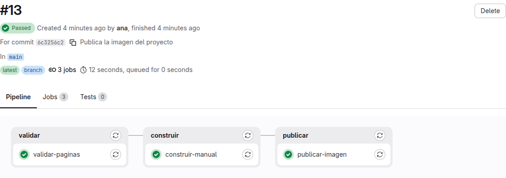
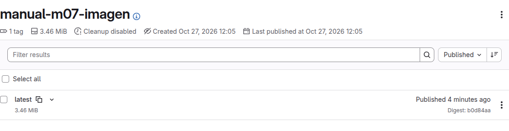

# Lab — Imagen del proyecto

[← Página anterior](00-imagen-y-release.md) · [Siguiente página →](02-lab-release.md)

Quien se incorpora no va a abrir el repositorio para leer el proyecto: va a ejecutar una imagen y ver el documento. En este lab escribes el `Dockerfile`, lo pruebas en el Codespace y dejas que el pipeline publique la imagen en el registro de GitLab.

### Objetivo

Dejar en el registro de `ana/manual-m07-imagen` la imagen `gitlab:5050/ana/manual-m07-imagen:latest`, construida por el pipeline, y comprobar con `docker run` que incluye una frase que solo está en este cambio.

### Punto de partida

- El entorno de prácticas levantado ([El entorno de prácticas](../../infra/README.md)): GitLab en `http://localhost:8080`, registro en `gitlab:5050` y su runner. Cuenta `ana`, contraseña `Formacion-2026!`.
- Estado: en el terminal del Codespace, ejecuta:

  ```bash
  # 🖥️ Terminal del Codespace
  scripts/partida.sh ana manual-m07-imagen --con-ci
  docker exec -it pc-ana bash
  ```

  Crea `ana/manual-m07-imagen` con el contenido del proyecto y cuatro commits; el último, «Añade pipeline de validación», trae el `.gitlab-ci.yml` con los stages `validar` y `construir`. Lo clona en `~/trabajo/manual-m07-imagen` del ordenador de Ana y lanza un primer pipeline. El segundo comando te sienta en el ordenador de Ana.

### En qué consiste

Añades una frase a la bienvenida, escribes el `Dockerfile`, compruebas la imagen en local, y publicas con un job nuevo, `publicar-imagen`. No cambias `scripts/validar.sh` ni `scripts/construir.sh`.

### 1 — Deja una frase que identifique este cambio

**Acción** (📝 VS Code, ordenador de Ana): en `home-ana/trabajo/manual-m07-imagen/docs/bienvenida.md`, debajo del primer párrafo, añade esta línea y guarda:

```markdown
La versión publicada de este proyecto viaja en una imagen.
```

**Por qué:** cuando ejecutes la imagen sabrás que se ha construido con este commit: la frase solo está aquí.

**Resultado esperado:** el párrafo de la bienvenida queda así:

```markdown
# Bienvenida

Te damos la bienvenida al equipo. Este manual reúne lo que necesitas durante tus primeras semanas.

La versión publicada de este proyecto viaja en una imagen.
```

### 2 — Escribe el Dockerfile

**Acción** (📝 VS Code, ordenador de Ana): crea `home-ana/trabajo/manual-m07-imagen/Dockerfile` con este contenido y guarda:

```dockerfile
FROM alpine:3.20
COPY public/manual-completo.md /manual/manual-completo.md
CMD ["cat", "/manual/manual-completo.md"]
```

**Por qué:** la imagen no lleva el repositorio entero. Lleva el documento que ya genera `scripts/construir.sh`, y al ejecutarla lo imprime.

**Resultado esperado:**

```text
 M docs/bienvenida.md
?? Dockerfile
```

### 3 — Genera el documento en el ordenador de Ana

**Acción** (💻 Ordenador de Ana):

```bash
# 💻 Ordenador de Ana
cd ~/trabajo/manual-m07-imagen
sh scripts/construir.sh
```

**Por qué:** `COPY` necesita `public/manual-completo.md` en el directorio. En el pipeline lo dejará el artefacto de `construir-manual`. En local lo generas tú, con el mismo script, para probar el `Dockerfile` antes de publicarlo.

**Resultado esperado:**

```text
Generado public/manual-completo.md (67 líneas)
```

### 4 — Construye y ejecuta la imagen en el Codespace

**Acción** (🖥️ Terminal del Codespace): sal del ordenador de Ana con `exit` si sigues dentro, y ejecuta:

```bash
# 🖥️ Terminal del Codespace
cd home-ana/trabajo/manual-m07-imagen
docker build -t manual-local .
docker run --rm manual-local | grep viaja
```

**Por qué:** `docker` está en el Codespace, no en el ordenador de Ana. `manual-local` es un nombre solo para esta prueba. El registro usará otro, el que asigna GitLab.

**Resultado esperado:** la construcción termina con `naming to docker.io/library/manual-local` y el `grep` imprime:

```text
La versión publicada de este proyecto viaja en una imagen.
```

> [!WARNING]
> Si `docker build` dice que no encuentra `public/manual-completo.md`, el paso 3 no se ha ejecutado en este directorio, o has borrado `public/` antes de tiempo.

### 5 — Borra la copia local de `public/`

**Acción** (📝 VS Code, ordenador de Ana): en el explorador, borra la carpeta `home-ana/trabajo/manual-m07-imagen/public/` (clic derecho → **Delete**).

**Por qué:** `public/` es un resultado. Si entra en el commit, el repositorio guarda un documento que el pipeline vuelve a generar.

**Resultado esperado:** `git status --short` muestra solo ` M docs/bienvenida.md` y `?? Dockerfile`.

### 6 — Añade el job que publica

**Acción** (📝 VS Code, ordenador de Ana): sustituye `home-ana/trabajo/manual-m07-imagen/.gitlab-ci.yml` por este contenido y guarda:

```yaml
stages:
  - validar
  - construir
  - publicar

validar-paginas:
  stage: validar
  image: alpine:3.20
  script:
    - sh scripts/validar.sh

construir-manual:
  stage: construir
  image: alpine:3.20
  script:
    - sh scripts/construir.sh
  artifacts:
    paths:
      - public/
    expire_in: 1 week

publicar-imagen:
  stage: publicar
  image:
    name: docker:27-cli
    entrypoint: [""]
  script:
    - docker login -u "$CI_REGISTRY_USER" -p "$CI_REGISTRY_PASSWORD" "$CI_REGISTRY"
    - docker build -t "$CI_REGISTRY_IMAGE:latest" .
    - docker push "$CI_REGISTRY_IMAGE:latest"
```

**Por qué:** `publicar` va después de `construir`, así que el job recibe `public/` como artefacto y el `COPY` del `Dockerfile` lo encuentra. `CI_REGISTRY_IMAGE` es la ruta de la imagen de este proyecto en el registro (`gitlab:5050/ana/manual-m07-imagen`). `:latest` es el tag de la imagen: la publicación más reciente, no un tag de Git. Las variables `CI_REGISTRY_*` las rellena GitLab; no las escribes tú. `entrypoint` vacío deja que el runner ejecute el `script`.

**Resultado esperado:** el archivo tiene tres jobs y la lista `stages` incluye `publicar`.

### 7 — Registra y publica el cambio

**Acción** (💻 Ordenador de Ana):

```bash
# 💻 Ordenador de Ana
cd ~/trabajo/manual-m07-imagen
git add docs/bienvenida.md Dockerfile .gitlab-ci.yml
git commit -m "Publica la imagen del proyecto"
git push
```

**Por qué:** el push lanza el pipeline. El job nuevo es el que sube la imagen; Git solo sube los commits.

**Resultado esperado:** el commit informa de 3 archivos cambiados y el push termina en `main -> main`. `git status` dice `nothing to commit, working tree clean`.

### 8 — Sigue el pipeline por sus tres stages

**Acción** (🌐 GitLab, sesión de Ana): abre **Build → Pipelines** y entra en el pipeline del commit «Publica la imagen del proyecto».

**Por qué:** `publicar-imagen` solo empieza si `construir-manual` ha guardado el artefacto. Una página rota no llega a publicarse.

**Resultado esperado:** el grafo muestra `validar`, `construir` y `publicar`, en ese orden. Los tres jobs terminan en **Passed**.



### 9 — Busca la subida en el log

**Acción** (🌐 GitLab, sesión de Ana): abre el job `publicar-imagen` y ve al final del log.

**Por qué:** el log es la prueba de que la imagen ha llegado al registro, no solo de que el `Dockerfile` está en el repositorio.

**Resultado esperado:** aparece `Login Succeeded`, después el nombre `gitlab:5050/ana/manual-m07-imagen:latest`, y al final una línea `latest: digest: sha256:` seguida de `Job succeeded`.

### 10 — Mira la imagen en el registro

**Acción** (🌐 GitLab, sesión de Ana): en la barra lateral del proyecto, abre **Deploy → Container registry**. Entra en el repositorio de la imagen.

**Por qué:** es el sitio donde el equipo encuentra lo publicado, sin leer el log.

**Resultado esperado:** un tag, `latest`, con el nombre de la imagen `gitlab:5050/ana/manual-m07-imagen`.



### 11 — Ejecuta la imagen que ha publicado el pipeline

**Acción** (🖥️ Terminal del Codespace):

```bash
# 🖥️ Terminal del Codespace
docker login gitlab:5050 -u ana -p 'Formacion-2026!'
docker run --rm gitlab:5050/ana/manual-m07-imagen:latest | grep viaja
```

**Por qué:** esta imagen no es `manual-local`. Es la que ha construido el runner y ha guardado el registro. La contraseña va entre comillas simples para que la terminal no interprete el `!`.

**Resultado esperado:** Docker avisa de que la contraseña va en el comando y de que la guarda sin cifrar. Después imprime `Login Succeeded`. Los avisos no son un fallo. El `grep` muestra otra vez la frase:

```text
La versión publicada de este proyecto viaja en una imagen.
```

## Comprueba tu entendimiento

**La imagen publicada no está en el repositorio**
En el ordenador de Ana, `git status` dentro de `~/trabajo/manual-m07-imagen`.
→ `nothing to commit, working tree clean`. No hay `public/` ni una imagen dentro del commit: en el commit están el `Dockerfile` y el `.gitlab-ci.yml`.

**`latest` es de esta ejecución**
En **Deploy → Container registry**, abre el tag `latest` y mira la fecha.
→ Es la del pipeline del commit «Publica la imagen del proyecto», posterior a la del pipeline inicial, que no tenía job de imagen.

## Reto

### 1 — Publicar también el commit corto

Haz que `publicar-imagen` suba la misma imagen con un segundo tag: el identificador corto del commit (`CI_COMMIT_SHORT_SHA`).

<details>
<summary>Ver solución</summary>

En el `script` del job, añade una etiqueta y su `docker push` después del de `latest`:

```yaml
    - docker build -t "$CI_REGISTRY_IMAGE:latest" -t "$CI_REGISTRY_IMAGE:$CI_COMMIT_SHORT_SHA" .
    - docker push "$CI_REGISTRY_IMAGE:latest"
    - docker push "$CI_REGISTRY_IMAGE:$CI_COMMIT_SHORT_SHA"
```

Commit, push y, en **Deploy → Container registry**, aparecen `latest` y un tag de ocho caracteres, el mismo que muestra el pipeline junto al commit.

</details>

## Errores frecuentes

| Síntoma | Causa probable | Cómo arreglarlo |
|---------|----------------|-----------------|
| `docker build` no encuentra `public/manual-completo.md` | Falta el documento en el directorio de la construcción | En local, `sh scripts/construir.sh` antes del `docker build`. En el pipeline, el job tiene que estar en la stage `publicar`, después de `construir` |
| `publicar-imagen` en **Pending** | El runner no está disponible | En el terminal del Codespace, `infra/bootstrap.sh` |
| `Cannot connect to the Docker daemon` en el log del job | El runner no tiene montado el Docker del Codespace | `infra/bootstrap.sh` otra vez: deja el socket a los jobs |
| `http: server gave HTTP response to HTTPS client` | Docker no acepta el registro por HTTP | `infra/bootstrap.sh` otra vez: autoriza `gitlab:5050` |
| `Login Succeeded` no aparece y el push responde `unauthorized` | El registro de GitLab aún no responde, o el job no usa las variables `CI_REGISTRY_*` | `curl -s -o /dev/null -w '%{http_code}\n' http://gitlab:5050/v2/` tiene que devolver `401`. Revisa que el `docker login` del job es el del paso 6 |
| `git status` muestra `?? public/` | Se ejecutó `construir.sh` y la carpeta sigue ahí | Bórrala en VS Code antes del `git add` |
| El `grep viaja` no imprime nada | La frase no está en `docs/bienvenida.md`, o la imagen es de un pipeline anterior | Abre la bienvenida, confirma la frase, vuelve a hacer commit y push, y ejecuta el tag `latest` de ese pipeline |
